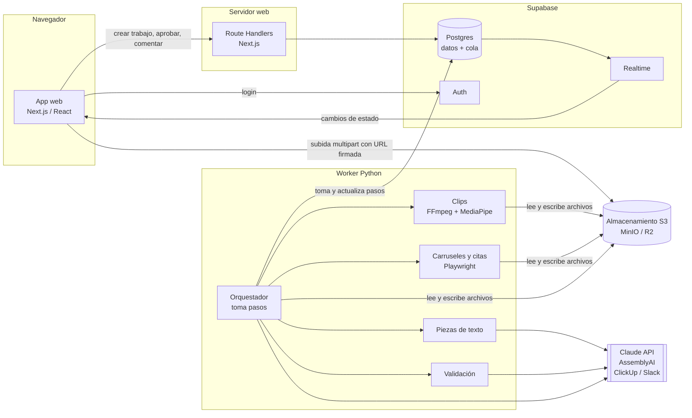
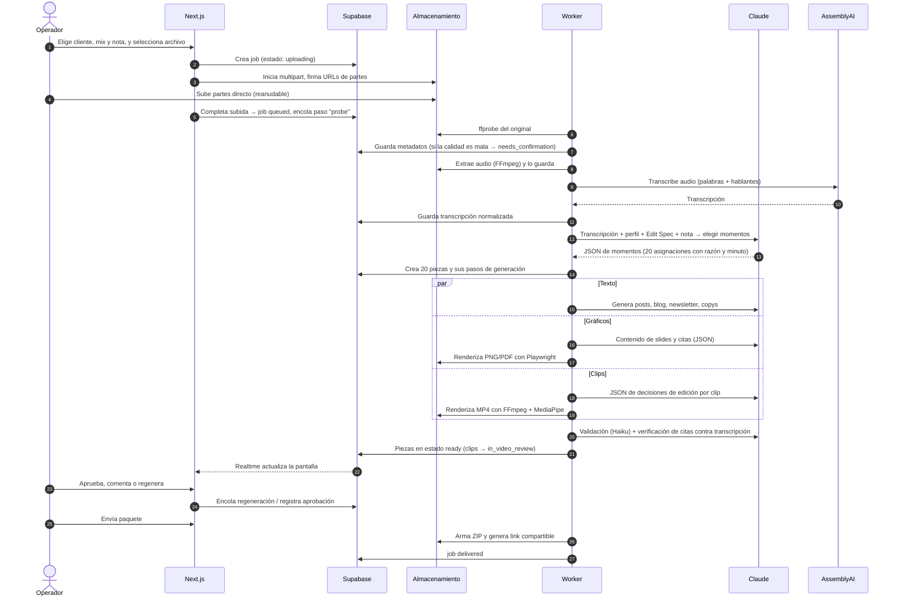
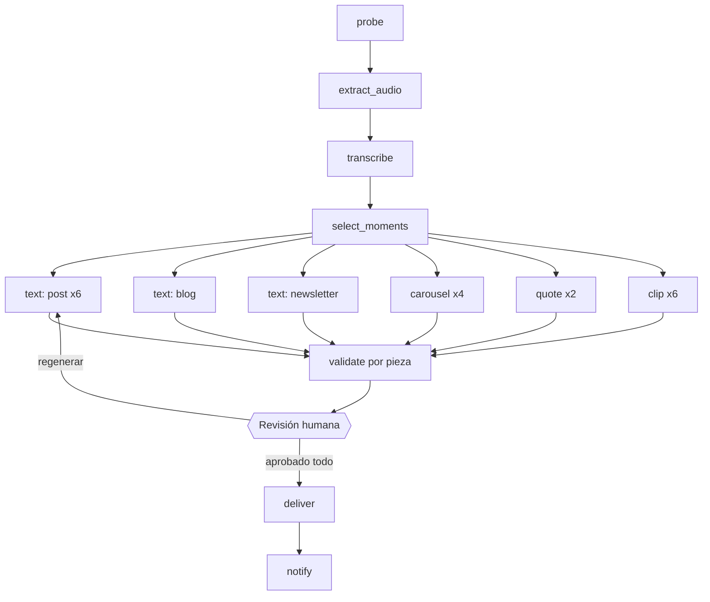
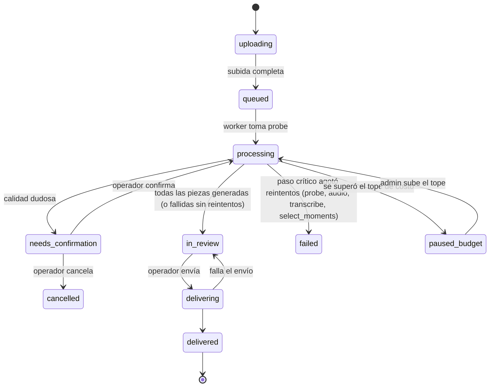

# 01 · Arquitectura del sistema

**Proyecto:** Content Engine (AEO.co) · **Fecha:** 12 de noviembre de 2026 · **Autor:** Alex Tigselema
**Fuentes:** documento de requerimientos (11 nov 2026) y `00-resumen-decisiones.md`.

Este documento describe los componentes, cómo se comunican y el recorrido completo de un video desde la subida hasta el envío del paquete. Los detalles de tablas, JSON de edición, worker y prompts van en los documentos 02 a 05.

---

## 1. Principios

1. **Claude decide, el worker ejecuta.** Claude recibe texto (transcripción, perfil, Edit Spec) y devuelve JSON validado contra un esquema. Nunca toca archivos de video. El worker aplica ese JSON con FFmpeg, MediaPipe y Playwright.
2. **Postgres es la fuente de verdad del estado.** Cada trabajo y cada paso tiene una fila con su estado. La UI se entera de los cambios por Supabase Realtime; no hay estado escondido en memoria del worker.
3. **El video nunca pasa por Next.js.** El navegador sube directo al almacenamiento con URLs firmadas y el worker lee desde ahí. Next.js solo maneja metadatos.
4. **Las API keys de IA viven solo en el worker.** Next.js no llama a Claude ni a AssemblyAI: encola pasos y el worker los ejecuta (RNF-04). Esto también hace que generar y regenerar usen el mismo código.
5. **Todo proveedor va detrás de un adaptador.** Transcripción, LLM, almacenamiento, entrega y avisos tienen una interfaz propia (RNF-08).
6. **Cada paso es idempotente y reintentable.** Un paso escribe sus salidas con claves deterministas; si se repite, sobrescribe en lugar de duplicar (RNF-03).
7. **Cada trabajo congela la versión del Edit Spec que usó.** Así una pieza siempre se puede reproducir y se sabe con qué reglas se generó.

---

## 2. Estilo de arquitectura y escalabilidad

La escalabilidad se revisa en tres ejes, porque cada uno se resuelve distinto:

| Eje | Pregunta | Dónde |
| --- | --- | --- |
| **Carga** | ¿Aguanta más videos sin volverse lento? | §2.3 |
| **Inquilinos (SaaS)** | ¿Se puede ofrecer a otras agencias? | §2.4 (fuera del MVP) |
| **Funcionalidades** | ¿Se pueden agregar piezas, módulos e integraciones sin tocar el núcleo? | §2.5 |

Criterio general: es un MVP para una sola agencia. Se diseña para **carga y funcionalidades** desde el inicio; **multiinquilino queda fuera del alcance** (decidido el 12 nov).

### 2.1 Estilo elegido

**Monolito modular con worker asíncrono y cola de trabajos.** Son dos unidades que se despliegan por separado:

- **Web (Next.js):** interfaz y API liviana. Sin estado propio: todo vive en Postgres y en el almacenamiento.
- **Worker (Python):** todo lo pesado y largo. Varios procesos iguales toman pasos de la misma cola.

**"Modular" quiere decir módulos con límites explícitos**, no carpetas por tipo de archivo. Cada módulo es dueño de sus tablas, su lógica y su interfaz pública; otro módulo no lee sus tablas directamente, le pide los datos por esa interfaz o reacciona a sus eventos.

| Módulo | Responsabilidad | Tablas propias (detalle en `02-modelo-de-datos.md`) |
| --- | --- | --- |
| `auth` | Usuarios, roles, asignaciones, configuración general de la app | `profiles`, `client_assignments`, `app_settings` |
| `clients` | Clientes, perfil, Edit Spec versionado, recursos de marca | `clients`, `client_profile_versions`, `brand_assets`, `profile_examples`, `edit_spec_imports` |
| `ingest` | Subida, validación, transcripción | `transcripts` (la fuente vive en `jobs`) |
| `pipeline` | Trabajos, pasos, cola, reintentos | `jobs`, `job_steps` |
| `pieces` | Tipos de pieza, generación, versiones, render | `pieces`, `piece_versions` |
| `review` | Aprobación, comentarios, correcciones, reglas propuestas | `corrections`, `rule_proposals` |
| `delivery` | ZIP, links compartibles, destinos de entrega | `packages`, `package_shares` |
| `usage` | Costos, topes, métricas | `cost_events` (topes en `clients` y `app_settings`) |
| `integrations` | ClickUp, Slack, webhooks; se suscriben a eventos | `outbox_events` |

Por dentro de cada unidad, el código va en **capas con puertos y adaptadores** (arquitectura hexagonal):

| Capa | Web (TypeScript) | Worker (Python) | Regla |
| --- | --- | --- | --- |
| Entrada | `app/` (páginas y Route Handlers) | `orchestrator/` (toma pasos de la cola) | Solo traduce: recibe la petición o el paso y llama a un caso de uso. |
| Casos de uso | `modules/<módulo>/server/` | `modules/<módulo>/steps/` | Orquesta dominio y adaptadores. |
| Dominio | `schemas/` compartidos | `modules/<módulo>/domain/` | Código puro: sin red, sin disco, sin base de datos. |
| Adaptadores | `lib/` (Supabase, S3) | `adapters/` (Claude, AssemblyAI, S3, Postgres) | Único lugar que habla con servicios externos. |

La regla clave: **el dominio no importa adaptadores.** Así la parte más delicada (convertir el JSON de decisiones en comandos de FFmpeg) se prueba con tests unitarios, sin red ni videos grandes. Los límites entre módulos se pueden verificar en CI (por ejemplo, con `dependency-cruiser` en TypeScript e `import-linter` en Python).

### 2.2 Por qué no microservicios (ni un backend aparte por ahora)

- Un desarrollador, un solo dominio y unos 40 videos al mes (unos 2 por día hábil).
- Separar en servicios agrega red entre ellos, despliegues coordinados, contratos versionados y monitoreo distribuido, y a esta escala no da nada a cambio.
- La única separación que sí importa ya existe: **lo interactivo (web) y lo pesado (worker) escalan distinto**, por eso son dos unidades.
- Supabase cubre login, permisos (RLS) y tiempo real; la API que queda en Next.js es delgada.
- Como los módulos tienen límites explícitos, **separar uno como servicio después es mover una carpeta detrás de una API**, no reescribir. Las señales para hacerlo están en §2.6.

### 2.3 Escalar en carga

Meta de diseño: soportar **10 veces la carga esperada (unos 400 videos al mes)** sin cambiar la arquitectura, solo agregando máquinas.

| Parte | Qué la limita | Cómo escala |
| --- | --- | --- |
| Web | Casi nada (consultas y firma de URLs) | Sin estado: Vercel la escala sola. |
| Subidas de video | Ancho de banda | Van directo del navegador al almacenamiento; el servidor no toca los bytes. |
| Postgres y la cola | Filas de pasos (~40 por video, ~16.000 al mes con 400 videos) | Muy poco para Postgres. Índice sobre `(queue, status, run_after)`. |
| Worker de API (`io`) | Límites de tasa de Claude y AssemblyAI | Muchos pasos en paralelo en una máquina pequeña, con un límite de concurrencia por proveedor. |
| Worker de render (`cpu`) | CPU: FFmpeg y MediaPipe | Horizontal: más procesos o más máquinas tomando pasos `cpu`. Es el cuello de botella real. |
| Almacenamiento | — | R2 no tiene límite práctico ni cobra salida de datos. |

Mecanismos concretos:

1. **Cola en Postgres con `SELECT … FOR UPDATE SKIP LOCKED`.** Varios workers toman pasos sin chocar y sin un coordinador central. No hace falta Redis ni Kafka.
2. **Dos colas por tipo de recurso:** `io` (llamadas a APIs, mucha concurrencia, poca CPU) y `cpu` (render, concurrencia igual a la mitad de los núcleos). Así un lote de clips no frena la regeneración de un post. En despliegue pueden correr en máquinas de distinto tamaño.
3. **Pasos pequeños, idempotentes y sin estado local:** cualquier worker puede tomar cualquier paso, así que escalar es agregar procesos.
4. **Límites por proveedor y topes de costo** (§10): crecer en volumen no dispara el gasto sin control.

### 2.4 SaaS (varias organizaciones): fuera del MVP

El MVP es para una sola organización, AEO.co. No se construye multiinquilino: ni `org_id`, ni membresías, ni registro público, ni cobro. El requerimiento también lo deja fuera de alcance.

Si más adelante se decide venderlo, el camino es el modelo de base compartida con `org_id` + RLS. Habría que agregar `org_id` a las tablas de negocio, mover el rol a una tabla de membresías, ajustar las políticas RLS y prefijar las claves del bucket por organización. Es una migración de trabajo medio, que se hace antes de abrir la herramienta a otra organización. Como el código y las cuentas son de AEO.co (RNF-09), esa decisión se toma con ellos.

### 2.5 Escalar en funcionalidades (módulos y tipos de pieza)

Agregar funcionalidades no debe obligar a tocar el núcleo. Tres mecanismos:

**1. Tipos de pieza como plugins (registro).** Cada tipo de pieza (clip, carrusel, post, blog, newsletter, cita) es un módulo que se registra con un contrato fijo:

| Parte del contrato | Ejemplo para "carrusel" |
| --- | --- |
| `key`, nombre, ícono | `carousel`, "Carrusel" |
| Esquema del contenido (JSON Schema) | Lista de slides con título, cuerpo y CTA |
| Prompt(s) | `prompts/carousel/generate.md` |
| Generador | Paso que pide el JSON a Claude |
| Renderizador | Plantilla HTML → PNG + PDF con Playwright |
| Validaciones | Número de slides, largo de texto, CTA presente |
| Cola que usa | `io` para generar, `cpu` para renderizar |
| Componente de vista previa en la UI | Tarjeta con carrusel deslizable |

El orquestador arma el grafo de pasos leyendo el mix de piezas y el registro; no tiene una lista fija de tipos. **Agregar "miniatura de YouTube" o "hilo de X" es agregar una carpeta, no modificar el pipeline.** Esto cumple RNF-10 ("cómo agregar un formato nuevo de pieza").

**2. Eventos de dominio (outbox).** Los módulos publican eventos en la tabla `outbox_events` dentro de la misma transacción que el cambio: `job.created`, `piece.ready`, `piece.approved`, `package.delivered`, `budget.exceeded`. Un despachador los entrega a quien esté suscrito:

- ClickUp y Slack (RF-18) son suscriptores, no código metido en el pipeline.
- Más adelante, webhooks, analítica o publicación en redes (RF-22) se suscriben igual.
- El núcleo no sabe quién escucha; agregar una integración no lo toca.

**3. Funciones activables por cliente.** Revisor de video, B-roll, validación con Haiku, nuevos tipos de pieza: cada uno se activa en el perfil del cliente (y los valores por defecto en `app_settings`). Permite lanzar algo a un solo cliente, probarlo y luego abrirlo a todos.

### 2.6 Señales para revisar la arquitectura

| Señal | Acción |
| --- | --- |
| Los pasos `cpu` esperan más de 15 minutos de forma sostenida | Más máquinas de render, o evaluar render con GPU. |
| Se necesitan prioridades complejas, cron o más de ~1.000 pasos por minuto | Mover la ejecución a Trigger.dev o a una cola dedicada (SQS); la tabla de pasos se queda como registro. |
| Se decide vender a otras agencias | Migración a multiinquilino (§2.4), luego registro, planes y cobro. |
| La API la consumen otros sistemas o una app móvil, o la lógica en `modules/*/server/` crece mucho | Extraer un backend propio (NestJS o FastAPI) con esos mismos casos de uso; Next.js queda solo como frontend. |
| Otro equipo empieza a trabajar en una parte (por ejemplo, el motor de clips) | Separar ese módulo como servicio propio, detrás de su interfaz. |
| Postgres empieza a sufrir | Plan mayor de Supabase y réplicas de lectura. |


---

## 3. Componentes

| Componente | Tecnología | Responsabilidad |
| --- | --- | --- |
| **App web** | Next.js (App Router) + React + TypeScript | Login, clientes y Edit Spec, subida, pantalla de revisión, historial, métricas. Route Handlers para firmar URLs, crear trabajos, encolar regeneraciones y crear cuentas (admin). |
| **Supabase** | Postgres, Auth, Realtime | Datos de negocio, cola de pasos, estado en vivo, cuentas con correo y contraseña (registro público desactivado), permisos por rol con RLS. |
| **Almacenamiento de objetos** | API S3: MinIO en local, Cloudflare R2 en despliegue | Videos originales, audio extraído, transcripciones crudas, piezas renderizadas (MP4, PNG, PDF, HTML), recursos de marca (logos, tipografías, música, intros), ZIP del paquete. |
| **Worker** | Python 3.12 (uv), procesos múltiples | Toma pasos de la cola, ejecuta el pipeline, llama a Claude y AssemblyAI, renderiza, registra costos y actualiza estados. |
| **Motor de clips** | FFmpeg + MediaPipe (dentro del worker) | Corta, reencuadra a 9:16, quita silencios y muletillas, subtitula, pone logo, zooms, música, intro y outro según el JSON de decisiones. |
| **Motor de gráficos** | Playwright (Chromium headless) + plantillas HTML por cliente | Renderiza carruseles (PNG por slide + PDF) y gráficos de cita (PNG). |
| **Servicios externos** | Claude API y AssemblyAI; luego ClickUp, Slack, Pexels y Sentry | Ver tabla de credenciales en el resumen de decisiones. Google Drive queda fuera del MVP. |

### Diagrama de componentes



---

## 4. Recorrido completo de un video

Ejemplo: video de 1 hora, cliente con revisor de video activado, mix por defecto de 20 piezas.

### 4.1 Vista general



### 4.2 Paso a paso

| # | Paso | Quién | Entrada | Salida | Notas |
| --- | --- | --- | --- | --- | --- |
| 0 | **Crear trabajo** | Next.js | cliente, mix, nota, nombre de archivo | fila `jobs` en `uploading`, `edit_spec_version_id` congelado | Solo operadores asignados al cliente o admin. |
| 1 | **Subida** | Navegador → S3 | archivo hasta 10 GB | objeto `originals/{job_id}/source.ext` | Multipart S3 con URLs firmadas por parte (partes de 64 MB). Si se corta, se reanuda listando las partes ya subidas (RF-04). Los links de video (YouTube, Zoom, Loom) son P1 y usan un paso `fetch_source` en lugar de este. |
| 2 | **Probe** (RF-05) | Worker | original | duración, resolución, fps, pistas de audio, nivel de audio | Rechaza si pasa de 2 h o no tiene audio. Si la resolución es menor a 1080p de alto o el audio está muy bajo, pasa a `needs_confirmation` y el operador decide si sigue. El reloj de 60 minutos (RNF-01) arranca al terminar la subida. |
| 3 | **Extraer audio** | Worker | original | `audio/{job_id}.m4a` mono 16 kHz | Archivo liviano para AssemblyAI. |
| 4 | **Transcribir** (RF-06) | Worker → AssemblyAI | audio | `transcripts`: palabras con inicio/fin en ms, hablante y confianza; JSON crudo en S3 | La transcripción normalizada es el formato interno; el adaptador traduce la respuesta del proveedor. |
| 5 | **Elegir momentos** (RF-07) | Worker → Claude (Sonnet) | transcripción con marcas de tiempo + perfil + Edit Spec + nota + mix | JSON: por cada pieza, tipo, idea, rango(s) de tiempo, razón, hablante | Sin repetir tema entre piezas. Se valida que cada rango exista en la transcripción. Crea las filas de `pieces`. |
| 6a | **Piezas de texto** (RF-08) | Worker → Claude (Sonnet) | momento + fragmento de transcripción + voz del perfil + ejemplos aprobados | posts, blog (HTML + Markdown + schema FAQPage), newsletter, copys de clips y gráficos | Una llamada por pieza, en paralelo. Caché de prompts para el bloque fijo (perfil, Edit Spec, transcripción). |
| 6b | **Carruseles y citas** (RF-09) | Worker → Claude + Playwright | momento + plantilla HTML del cliente | JSON de slides → PNG por slide, PDF, PNG de cita | La frase de una cita debe ser textual: se toma de la transcripción por rango de palabras, no la escribe Claude. |
| 6c | **Clips** (RF-10) | Worker → Claude + FFmpeg + MediaPipe | momento + palabras del rango + Edit Spec | JSON de decisiones (rango fino, hook, cortes de muletillas y silencios, zooms, estilo) → MP4 1080x1920 H.264/AAC | Detalle en documento 03. Claude solo devuelve el JSON; el render es determinista. |
| 7 | **Validación** (RF-11, P1) | Worker → Claude (Haiku) + reglas | pieza + Edit Spec | lista de problemas por pieza | Chequeos deterministas primero (citas textuales, minuto de origen, duración, resolución, logo en su posición); Haiku revisa tono, prohibidos y errores. En Fase 1 solo corre la verificación de citas y cifras. |
| 8 | **Revisión de video** (RF-15) | Revisor | clips | aprobado o comentario | Solo si el cliente tiene la etapa activa. Los clips llegan al operador cuando el revisor termina. |
| 9 | **Revisión del operador** (RF-12, 13, 14) | Operador | 20 piezas | aprobar, editar texto, comentar, regenerar | Cada comentario se guarda como corrección (RF-17). Una regeneración crea una **nueva versión** de la pieza; las anteriores quedan en el historial. |
| 10 | **Envío** (RF-16) | Worker | piezas aprobadas | ZIP ordenado por formato en S3 + link compartible de solo lectura con vencimiento | El operador solo puede enviar cuando las 20 (o las del mix) están aprobadas. Puede descargar el ZIP o copiar el link para mandárselo al cliente. Ver §9.1. |
| 11 | **Avisos** (RF-18, P1) | Worker | evento `ready_for_review` / `delivered` | tarea en ClickUp, mensaje en Slack | Fase 3. |

### 4.3 Grafo de pasos

Los pasos forman un grafo, no una lista. Cada paso tiene dependencias y el orquestador solo toma pasos cuyas dependencias terminaron.



Puntos a notar:

- La validación corre por pieza, apenas esa pieza termina; el operador puede empezar a revisar el texto mientras los clips siguen renderizando.
- Una regeneración es un paso nuevo del mismo tipo con el comentario como entrada adicional. No reinicia el trabajo.
- `select_moments` es el único paso que, al repetirse, invalida todo lo de abajo. Por eso no se expone como "regenerar" en la UI del MVP.

---

## 5. Estados

### 5.1 Trabajo (`jobs.status`)



### 5.2 Pieza (`pieces.status`)

`pending → generating → validating → in_video_review (solo clips con revisor) → ready → approved`
Desde `ready`: `regenerating → validating → ready` (nueva versión).
Si la generación falla tras los reintentos: `failed`, con botón de reintentar en la tarjeta. Una pieza fallida no bloquea las demás.

### 5.3 Paso (`job_steps.status`)

`waiting → pending → running → succeeded | failed | cancelled`. Un paso `running` tiene `locked_until` (lease); si el worker muere, el lease vence y otro worker lo retoma. Detalle en `04-worker.md`.

---

## 6. Otras entradas

| Entrada | Prioridad | Qué cambia en el flujo |
| --- | --- | --- |
| Video subido (MP4, MOV, MKV) | P0 | Flujo completo. |
| Links de YouTube, Zoom, Loom (y Drive si se retoma) | P1 | Paso `fetch_source` antes de `probe`, con un adaptador por origen. |
| Audio (MP3, WAV, M4A) | Fase 3 | Se salta el reencuadre y no se crean clips. El mix se ajusta y la UI lo muestra antes de confirmar. |
| Documento o texto (PDF, DOCX, TXT, MD, URL, pegado) | Fase 3 | Se salta `probe`, `extract_audio` y `transcribe`; un paso `extract_text` produce el mismo formato de "fuente" con párrafos en lugar de tiempos. El minuto de origen pasa a ser "párrafo de origen". |

Audio y documentos van en la Fase 3 (decidido el 12 nov): reutilizan el pipeline de texto sin trabajo de video.

---

## 7. Adaptadores

Interfaces en el worker (Python, `Protocol`). La implementación activa se elige por variable de entorno.

| Interfaz | Métodos principales | Implementación MVP | Alternativas |
| --- | --- | --- | --- |
| `TranscriptionProvider` | `transcribe(audio_url) -> Transcript` | AssemblyAI | Deepgram, Whisper |
| `LLMProvider` | `generate_json(prompt, schema, model_role) -> (data, usage)` | Claude (Sonnet para generar, Haiku para validar) | Cualquier modelo con salida estructurada |
| `ObjectStorage` | `put`, `get`, `presign_get`, `presign_put_part`, `delete` | S3 (boto3) apuntando a MinIO o R2 | AWS S3 |
| `SourceFetcher` | `fetch(url) -> object_key` | — (el MVP solo acepta subida directa) | YouTube, Zoom, Loom, Google Drive (P1) |
| `DeliveryTarget` | `deliver(package) -> location` | ZIP en S3 + link compartible | Google Drive, Dropbox, carpeta compartida |
| `Notifier` | `notify(event)` | sin efecto en MVP | ClickUp, Slack (Fase 3) |
| `StockFootage` | `search(query) -> clips` | — | Pexels (P1) |

Reglas:

- El resto del código solo usa tipos internos (`Transcript`, `Word`, `Moment`, `EditDecision`), nunca la respuesta cruda de un proveedor.
- Los nombres de modelo no se escriben en el código: `model_role` (`generate`, `validate`) se resuelve a un ID de modelo desde configuración. Así cambiar de modelo es un cambio de variable.
- Cada llamada devuelve su uso (tokens, segundos de audio) para el registro de costos.

En Next.js el único adaptador es el de almacenamiento (firmar URLs), con el SDK de AWS v3 apuntando al mismo endpoint S3.

---

## 8. Almacenamiento

### 8.1 Decisión: MinIO en local para todos los archivos

Confirmado el 12 nov. Se usa **MinIO** en local (y R2 en despliegue) para todos los archivos binarios, en lugar de Supabase Storage:

- La subida reanudable con multipart S3 y URLs firmadas funciona igual en MinIO y en R2. Supabase Storage usa TUS para subidas reanudables, que es otro protocolo en el navegador; el código de subida cambiaría al pasar a R2.
- Un solo mecanismo de archivos en todo el sistema (worker y web).
- Supabase sigue a cargo de base de datos, Auth y Realtime.

MinIO corre con un `docker-compose.yml` junto a `supabase start`.

### 8.2 Estructura de claves

Un bucket privado `content-engine`:

```
originals/{job_id}/source.{ext}              # video, audio o documento original (retención 90 días, RNF-06)
work/{job_id}/audio.m4a                      # audio extraído (se borra con el original)
work/{job_id}/transcript.raw.json            # respuesta cruda del proveedor
work/{job_id}/clips/{piece_id}/...           # intermedios del render (se borran al terminar)
pieces/{job_id}/{piece_id}/v{n}/...          # salida final por versión: clip.mp4, slide-01.png, carousel.pdf, blog.html, blog.md
packages/{job_id}/package.zip                # paquete enviado
brand/{client_id}/...                        # logos, tipografías, música, intro/outro, plantillas HTML
```

- Nada es público. El navegador ve vistas previas con URLs firmadas de corta duración que genera Next.js después de verificar permisos.
- La retención de 90 días se aplica con una regla de ciclo de vida del bucket sobre `originals/` y `work/` (R2 y MinIO la soportan), más un campo `source_deleted_at` en `jobs` para que la UI lo sepa.

### 8.3 Lectura del video en el worker

- **MVP local:** el worker descarga el original una vez a un disco temporal del trabajo (`/tmp/ce/{job_id}`) y todos los pasos lo leen de ahí. Simple y rápido.
- **Despliegue:** FFmpeg lee solo los segmentos necesarios desde R2 con URL firmada (`-ss` antes de `-i`). Depende de que el MP4 tenga el índice (`moov`) al inicio; si no, la búsqueda por HTTP es lenta. A validar en la Fase 0 con videos reales; si falla, el paso `probe` hace un remux rápido sin recodificar.

---

## 9. Seguridad y permisos (RNF-04)

- **Cuentas:** correo y contraseña con Supabase Auth, registro público desactivado. El admin crea cuentas desde la app (Route Handler con `service_role`, solo en servidor). Opcional: rechazar correos que no sean del dominio de AEO.co.
- **Roles:** `operator`, `admin`, `video_reviewer` en la tabla `profiles`; asignación operador↔cliente en tabla aparte. Las políticas RLS filtran clientes, trabajos y piezas por rol y asignación. Detalle en el documento 02.
- **Realtime** respeta RLS: cada usuario solo recibe cambios de los trabajos que puede ver.
- **Claves:** `SUPABASE_SERVICE_ROLE_KEY` y credenciales S3 solo en el servidor de Next.js y en el worker. `ANTHROPIC_API_KEY` y `ASSEMBLYAI_API_KEY` solo en el worker.
- **Escrituras del navegador:** el navegador nunca escribe estados de trabajo ni de pasos. Aprobar, comentar o regenerar pasa por Route Handlers que validan rol y estado.

### 9.1 Link compartible del paquete

Reemplaza la copia a Google Drive de RF-16.

- Al enviar, el worker arma el ZIP y crea una fila en `package_shares` con un token aleatorio largo y fecha de vencimiento (por defecto 30 días, configurable).
- El link apunta a una ruta pública de la app (`/p/{token}`), no directo al bucket. Esa ruta valida el token y muestra una página simple con el paquete y botones de descarga, que generan URLs firmadas de pocos minutos.
- Ventajas frente a una URL firmada directa: el link se puede revocar o extender desde la app, se registra cuántas veces se abrió y el cliente ve las piezas ordenadas sin tener que descomprimir.
- Nada del bucket queda público; quien no tiene el token no ve nada.

---

## 10. Costos (RNF-05)

- Cada llamada externa inserta una fila en `cost_events` (`job_id`, `client_id`, proveedor, modelo, tokens de entrada/salida/caché, segundos de audio, costo en USD calculado con una tabla de precios en configuración).
- Antes de cada paso que llama a una API, el orquestador suma el costo del trabajo; si supera el tope (por cliente o global), el trabajo pasa a `paused_budget` y no se llama a nada más.
- El panel de métricas (RF-20) lee de `cost_events` agregados por trabajo y cliente.

---

## 11. Confiabilidad (RNF-03)

- **Reintentos automáticos** con espera exponencial por paso (por ejemplo, 3 intentos: 30 s, 2 min, 8 min). Errores no recuperables (archivo corrupto, sin audio) fallan sin reintentar.
- **Lease** en pasos `running`: si un worker se cae, el paso vuelve a estar disponible al vencer `locked_until`.
- **Idempotencia:** las salidas usan claves deterministas (`pieces/{job_id}/{piece_id}/v{n}/`); repetir un paso sobrescribe.
- **Visibilidad:** el operador ve en qué paso está cada trabajo y cada pieza, el número de intento y el último error legible.
- **Aislamiento entre trabajos** (RF-21): varios procesos del worker toman pasos de cualquier trabajo; un video largo no bloquea a otro. Los clips tienen un límite de concurrencia propio porque son los que usan CPU.

---

## 12. Presupuesto de tiempo (RNF-01 y RNF-02)

Estimación para un video de 1 hora en una máquina de 8 núcleos. **Se mide en la Fase 0 y la Fase 1.**

| Paso | Estimado |
| --- | --- |
| Probe + extracción de audio | 1–2 min |
| Transcripción (AssemblyAI) | 3–8 min |
| Elegir momentos (Claude, ~15k tokens de entrada) | 1–2 min |
| Texto, gráficos y clips en paralelo (los clips dominan: 6 × 2–5 min con 3 en paralelo) | 10–20 min |
| Validación | 1–3 min |
| **Total** | **~20–35 min** (meta: < 60 min) |

- Regenerar texto (< 1 min): una llamada a Claude con caché de prompts + validación. El worker debe reaccionar en segundos: Postgres le avisa al encolar con `LISTEN/NOTIFY`, un temporizador cubre los reintentos programados y una revisión cada 60 s cubre avisos perdidos (`04-worker.md` §3.3).
- Regenerar un clip (< 5 min): una llamada a Claude + un render. Si el comentario solo toca subtítulos o texto de pantalla (RF-14), se reutiliza el reencuadre ya calculado y solo se recompone la capa de texto.

---

## 13. Entornos

| Pieza | Local (MVP) | Despliegue |
| --- | --- | --- |
| Web | `next dev` | Vercel Pro o Netlify |
| Supabase | `supabase start` (Docker) | Proyecto en la nube; migraciones con la CLI |
| Archivos | MinIO (Docker) | Cloudflare R2 |
| Worker | Contenedor Docker con Docker Desktop (Windows), la misma imagen que en despliegue | Trigger.dev (máquinas grandes) o VPS con Docker — a decidir con datos de la Fase 2 |
| Dependencias del worker | Dentro de la imagen Docker: FFmpeg, MediaPipe, Playwright + Chromium, tipografías | La misma imagen |
| Repositorio | GitHub público personal | Se transfiere a la organización de AEO.co en la Fase 4 (RNF-09) |
| Errores | logs en consola | Sentry en web y worker |

Si se elige Trigger.dev, el worker deja de sondear la tabla y cada paso se dispara como tarea; la tabla `job_steps` se mantiene como registro de estado para la UI. Por eso el orquestador separa "decidir qué paso sigue" de "cómo se ejecuta".

---

## 14. Estructura del repositorio

La estructura completa del monorepo, las capas de cada módulo y las reglas de dependencia están en `06-arquitectura-del-codigo.md`. En resumen:

```
aeo-content-engine/
├── apps/web/            # Next.js
├── worker/              # Python: orchestrator, modules, piece_types, adapters, prompts
├── packages/schemas/    # contratos generados desde Pydantic (JSON Schema, TS, zod)
├── supabase/            # migraciones, pruebas pgTAP, seed
├── templates/           # plantillas HTML base
└── docs/
```

---

## 15. Trazabilidad de requisitos

| Requisito | Dónde se resuelve | Fase |
| --- | --- | --- |
| RF-01 Login y roles | Supabase Auth + perfiles + RLS (§9) | 1 |
| RF-02 Clientes, perfil y Edit Spec versionados | Web + tablas versionadas; el trabajo congela la versión | 1 |
| RF-03 Importar Edit Spec desde documento | Paso `import_edit_spec` (Claude → JSON del Edit Spec, admin confirma) | 3 |
| RF-04 Subida reanudable o link | Multipart S3 (§4.2 paso 1); links con `fetch_source` en P1 | 1 (subida), 3 (links) |
| RF-05 Validar archivo | Paso `probe` | 1 |
| RF-06 Transcripción | Paso `transcribe` + `TranscriptionProvider` | 1 |
| RF-07 Elegir momentos | Paso `select_moments` | 1 |
| RF-08 Piezas de texto | Pasos `text_*` | 1 |
| RF-09 Carruseles y citas | Pasos `carousel`, `quote` + Playwright | 2 |
| RF-10 Clips | Paso `clip` + motor de clips | 2 |
| RF-11 Revisión automática | Paso `validate` | 3 (verificación de citas desde la 1) |
| RF-12 Pantalla de revisión | Web + Realtime | 1 |
| RF-13 Regenerar con comentario | Route Handler encola paso; nueva versión de pieza | 1 |
| RF-14 Editar subtítulos y slides y re-renderizar | Paso `rerender` sin llamar a Claude | 3 |
| RF-15 Revisor de video | Estado `in_video_review` por cliente | 2 |
| RF-16 Envío del paquete | Paso `deliver`: ZIP + link compartible (§9.1). Drive fuera del MVP | 1 |
| RF-17 Guardar correcciones y proponer reglas | Tabla de correcciones + paso periódico que agrupa comentarios y propone reglas | 3 |
| RF-18 ClickUp y Slack | `Notifier` | 3 |
| RF-19 Historial | Web sobre `jobs`, `pieces`, versiones y aprobaciones | 1 |
| RF-20 Métricas y costos | `cost_events` + vistas agregadas | 3 |
| RF-21 Varios videos en cola | Cola con varios workers (§11) | 3 (el diseño lo soporta desde la 1) |
| RF-22 Publicar en redes | Fuera del MVP | — |
| RNF-01/02 Tiempos | §12 | 1–2 |
| RNF-03 Confiabilidad | §11 | 1 |
| RNF-04 Seguridad | §9 | 1 |
| RNF-05 Costos y tope | §10 | 1 (registro), 3 (panel) |
| RNF-06 Retención | Ciclo de vida del bucket (§8.2) | 4 |
| RNF-07 Inglés, laptop y celular | UI en inglés; pantalla de revisión responsive | 1 |
| RNF-08 Proveedores intercambiables | §7 | 1 |
| RNF-09 Propiedad | Repo personal transferido a AEO.co; cuentas de servicios a nombre de la agencia | 4 |
| RNF-10 Documentación | `docs/` + `worker/prompts/` | 4 |

---

## 16. Decisiones cerradas y puntos abiertos

**Cerrado el 12 de noviembre de 2026:**

- MinIO en local para todos los archivos (§8.1).
- Sin Google Drive en el MVP: entrega con ZIP + link compartible (§9.1). El adaptador `DeliveryTarget` permite conectar Drive u otro destino después.
- Audio y documentos como entrada en la Fase 3 (§6).
- Modelos: Sonnet para generar y Haiku para validar. El identificador exacto de cada modelo va en variables de entorno (`CLAUDE_MODEL_GENERATE`, `CLAUDE_MODEL_VALIDATE`), no en el código.
- Worker en Docker Desktop desde el MVP.
- Repo público personal, transferido a AEO.co en la Fase 4.
- Estilo de arquitectura: monolito modular + worker con cola (§2.1).
- Multiinquilino (SaaS) fuera del MVP: una sola organización, sin `org_id` (§2.4).
- Extensibilidad: tipos de pieza como plugins, eventos de dominio con outbox y funciones activables por cliente (§2.5).
- Material para la Fase 0: ya hay videos reales y Edit Specs de la agencia.
- Gráficos animados explicativos fuera de alcance; Edit Spec con reglas base + cliente (`03-edicion-de-clips.md`).
- Acceso a datos sin ORM: supabase-js con tipos generados y funciones `rpc`; psycopg + Pydantic en el worker.

**Abierto:**

1. **Reencuadre con dos hablantes:** se valida en la Fase 0 combinando MediaPipe con los hablantes de AssemblyAI (documento 03).
2. **Ejecución del worker en despliegue:** Trigger.dev o VPS, decidir con tiempos y costos reales medidos en la Fase 2.
3. **Avisar a la agencia del cambio en RF-16** (sin copia a Drive) y de los ajustes de alcance del resumen de decisiones.
