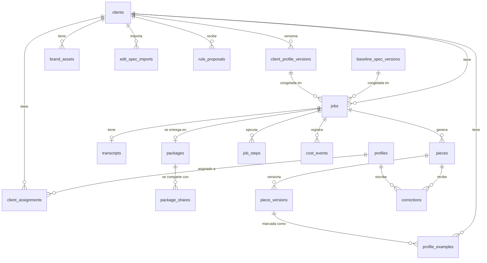

# 02 · Modelo de datos y permisos

**Proyecto:** Content Engine (AEO.co) · **Fecha:** 12 de noviembre de 2026 · **Autor:** Alex Tigselema
**Fuentes:** documento de requerimientos, `00-resumen-decisiones.md`, `01-arquitectura.md`.

Define las tablas de Supabase (Postgres), sus relaciones, el versionado, los permisos por rol con RLS y cómo se escriben los datos. Una sola organización (AEO.co): no hay `org_id`.

---

## 1. Decisiones de este documento

| Tema | Decisión | Origen |
| --- | --- | --- |
| Revisor de video | Se le asignan clientes igual que al operador; ve solo los clips de sus clientes asignados que tengan la etapa activa | Respuesta del 12 nov |
| Tope de costo (RNF-05) | Máximo en USD **por video**, configurable **por cliente** con un valor por defecto global. Si un trabajo lo supera, se pausa y el admin decide | Respuesta del 12 nov |
| Edición manual de texto | Cuenta como corrección: se guarda en la memoria de correcciones y la pieza no cuenta como "aprobada sin cambios" | Respuesta del 12 nov |
| Ejemplos aprobados del perfil | Los marca el admin desde el historial; también puede subir ejemplos externos | Respuesta del 12 nov |
| Perfil y Edit Spec | Se versionan juntos como un solo documento: cada cambio crea una versión nueva e inmutable. Cada trabajo congela la versión que usó | Requerimiento ("editable y versionado") + principio 7 de la arquitectura |
| Contenido del Edit Spec | JSON validado con `schemas/edit_spec.json`, no una columna por campo. Estructura en `03-edicion-de-clips.md` §2 | Las 15 áreas de la plantilla de la agencia mezclan valores exactos, reglas en texto y campos por confirmar |
| Reglas base + cliente | Las reglas base de la agencia son globales y versionadas (`baseline_spec_versions`); el Edit Spec del cliente las sobrescribe. Cada trabajo congela el spec efectivo | Proceso actual de la agencia (`ref_client-video-editing-rules.md`) |
| Origen de las correcciones | Cada corrección indica si es del cliente (con sus palabras) o interna | Respuesta del 12 nov; métrica de comentarios repetidos del cliente |
| Escrituras desde la app | El navegador solo **lee** (RLS + Realtime). Toda escritura pasa por funciones de Postgres (`rpc`) que validan rol, asignación y estado | Principio "el navegador nunca escribe estados" de la arquitectura |
| Costos | Solo el admin los ve (tabla `cost_events`) | Requerimiento: el admin "ve costos y métricas" |
| Acceso a datos | Sin ORM: supabase-js con tipos generados en Next.js, psycopg + Pydantic en el worker, migraciones SQL con la CLI de Supabase | Decisión del 12 nov |

---

## 2. Diagrama de entidades



---

## 3. Tipos enumerados

| Enum | Valores |
| --- | --- |
| `user_role` | `admin`, `operator`, `video_reviewer` |
| `client_status` | `active`, `archived` |
| `source_type` | `video_upload` (F1), `video_link` (P1), `audio` (F3), `document` (F3), `text` (F3) |
| `job_status` | `uploading`, `queued`, `processing`, `needs_confirmation`, `paused_budget`, `in_review`, `delivering`, `delivered`, `failed`, `cancelled` |
| `piece_type` | `clip`, `carousel`, `post`, `blog`, `newsletter`, `quote` |
| `piece_status` | `pending`, `generating`, `validating`, `in_video_review`, `ready`, `approved`, `failed` |
| `version_status` | `generating`, `ready`, `failed` |
| `version_origin` | `initial`, `regenerate`, `manual_edit`, `rerender` |
| `correction_kind` | `comment`, `manual_edit` |
| `step_status` | `waiting`, `pending`, `running`, `succeeded`, `failed`, `cancelled` |
| `step_queue` | `io`, `cpu` |
| `asset_kind` | `logo`, `font`, `music`, `sfx`, `intro`, `outro`, `end_card_template`, `carousel_template`, `quote_template`, `broll`, `image` |
| `correction_origin` | `internal`, `client` |
| `rule_status` | `proposed`, `accepted`, `rejected` |

Los estados de trabajo y pieza son los de `01-arquitectura.md` §5. `piece_type` es un enum en el MVP; si los tipos de pieza crecen como plugins (§2.5 de la arquitectura), se cambia a una tabla `piece_types`.

---

## 4. Tablas

Convenciones: `id uuid primary key default gen_random_uuid()`, `created_at timestamptz default now()`, nombres en inglés y en plural. La columna **Fase** indica cuándo se crea la tabla.

### 4.1 Usuarios y acceso

**`profiles`** · Fase 1 · un registro por usuario de Supabase Auth

| Columna | Tipo | Notas |
| --- | --- | --- |
| `id` | uuid PK | = `auth.users.id` |
| `email` | text | copia para mostrar |
| `full_name` | text | |
| `role` | `user_role` | un solo rol por usuario |
| `is_active` | boolean | desactivar en vez de borrar (un revisor temporal se desactiva) |
| `created_by` | uuid → profiles | el admin que creó la cuenta |

**`client_assignments`** · Fase 1 · qué clientes ve cada operador y revisor de video

| Columna | Tipo | Notas |
| --- | --- | --- |
| `client_id` | uuid → clients | PK compuesta |
| `user_id` | uuid → profiles | PK compuesta. Solo usuarios `operator` o `video_reviewer` |
| `created_by` | uuid → profiles | |

Un cliente puede tener varios operadores y un operador varios clientes. El admin no necesita asignación: ve todo.

**`app_settings`** · Fase 1 · una sola fila con valores por defecto

| Columna | Tipo | Notas |
| --- | --- | --- |
| `id` | int PK | siempre `1` (check) |
| `default_piece_mix` | jsonb | `{"clip":6,"carousel":4,"post":6,"blog":1,"newsletter":1,"quote":2}` |
| `default_cost_cap_per_video_usd` | numeric(10,2) | tope por defecto (RNF-05) |
| `source_retention_days` | int | 90 por defecto (RNF-06) |
| `share_link_days` | int | 30 por defecto (vencimiento del link compartible) |
| `current_baseline_version_id` | uuid → baseline_spec_versions | reglas base vigentes |
| `updated_by`, `updated_at` | | |

### 4.2 Clientes y perfil

**`clients`** · Fase 1 · RF-02

| Columna | Tipo | Notas |
| --- | --- | --- |
| `name` | text | |
| `status` | `client_status` | archivar en vez de borrar (RF-02) |
| `output_language` | text | `en-US` por defecto ("idioma del perfil del cliente") |
| `post_platforms` | text[] | `linkedin`, `facebook`, `x` ("según el cliente") |
| `blog_platform` | text | `shopify` o `wordpress` (formato del HTML del blog) |
| `piece_mix` | jsonb, null | mix propio; `null` = el de `app_settings` |
| `cost_cap_per_video_usd` | numeric, null | tope propio; `null` = el de `app_settings` |
| `video_review_enabled` | boolean | etapa del revisor de video (RF-15) |
| `broll_enabled` | boolean | P1 |
| `current_profile_version_id` | uuid → client_profile_versions | la versión vigente |
| `archived_at` | timestamptz | |

**`client_profile_versions`** · Fase 1 · RF-02, perfil "voz y estrategia" + Edit Spec

| Columna | Tipo | Notas |
| --- | --- | --- |
| `client_id` | uuid → clients | |
| `version` | int | único por cliente, empieza en 1 |
| `voice` | jsonb | ver estructura abajo |
| `edit_spec` | jsonb | áreas que sobrescriben las reglas base (`03-edicion-de-clips.md` §2.2), validado con `schemas/edit_spec.json` |
| `change_note` | text | qué cambió y por qué |
| `source` | text | `form`, `import`, `rule`, `rollback` |
| `source_import_id` | uuid, null | si vino de un import (RF-03) |
| `source_rule_id` | uuid, null | si vino de aceptar una regla (RF-17) |
| `created_by` | uuid → profiles | |

Reglas:
- **Inmutable:** no se actualiza ni se borra. Editar el perfil crea la versión `n+1` y mueve `clients.current_profile_version_id`.
- **Volver atrás** crea una versión nueva copiando una anterior (`source = 'rollback'`), así el historial nunca se pierde.
- "Ver qué cambió" se calcula comparando dos versiones en la app.

Estructura de `voice` (bloque 1 del requerimiento):

```json
{
  "business": "Descripción del negocio",
  "offer": "Oferta",
  "ideal_customer": "Avatar del cliente ideal",
  "tone": "Tono",
  "forbidden_words": ["..."],
  "forbidden_topics": ["..."],
  "preferred_phrases": ["..."],
  "glossary": ["Guidepost", "AEO"],
  "author": { "name": "Kyle Porter", "role": "Founder", "bio": "Bio corta", "photo_asset_id": "…" },
  "ctas": [{ "text": "Book a call", "url": "https://..." }]
}
```

`glossary` son nombres de marca y términos que deben escribirse exactamente así. Se envía a AssemblyAI como vocabulario y se usa al revisar subtítulos.

Estructura de `edit_spec` (bloque 2): las 15 áreas de la plantilla de la agencia, cada una con `status`, `params` y `rules`, más `never_do`, `references` y `qc_extras`. El detalle está en `03-edicion-de-clips.md` §2. Los archivos se referencian por `brand_assets.id`, nunca por ruta. El Edit Spec del cliente solo guarda lo que difiere de las reglas base.

**`baseline_spec_versions`** · Fase 1 · reglas base de la agencia (todos los clientes)

| Columna | Tipo | Notas |
| --- | --- | --- |
| `version` | int, único | empieza en 1 |
| `spec` | jsonb | misma estructura que `edit_spec`, con todas las áreas completas |
| `change_note` | text | |
| `created_by` | uuid → profiles | admin |

Inmutable, igual que las versiones del perfil. La vigente es `app_settings.current_baseline_version_id`.

**`brand_assets`** · Fase 1 · archivos de marca

| Columna | Tipo | Notas |
| --- | --- | --- |
| `client_id` | uuid → clients | |
| `kind` | `asset_kind` | |
| `name` | text | |
| `storage_key` | text | `brand/{client_id}/{id}.{ext}` en MinIO/R2 |
| `mime_type`, `size_bytes` | | |
| `metadata` | jsonb | dimensiones, duración, etc. |
| `archived_at` | timestamptz | |

Inmutable: un logo nuevo es un registro nuevo. Así una versión vieja del perfil sigue apuntando al logo que usaba.

**`profile_examples`** · Fase 1 · "ejemplos de piezas aprobadas en el pasado"

| Columna | Tipo | Notas |
| --- | --- | --- |
| `client_id` | uuid → clients | |
| `piece_type` | `piece_type` | Claude recibe ejemplos del mismo tipo |
| `piece_version_id` | uuid, null → piece_versions | si se marcó desde el historial |
| `external_content` | jsonb, null | si el admin pega o sube un ejemplo externo |
| `note` | text | por qué es buen ejemplo |
| `created_by` | uuid → profiles | siempre un admin |
| `removed_at` | timestamptz | |

Check: exactamente uno de `piece_version_id` o `external_content`. Los ejemplos **no** se versionan con el perfil; se usan los activos al momento de generar y el trabajo guarda en `job_steps.input` cuáles se usaron.

**`edit_spec_imports`** · Fase 3 · RF-03

| Columna | Tipo | Notas |
| --- | --- | --- |
| `client_id` | uuid → clients | |
| `file_storage_key` | text | PDF, DOCX o Google Doc exportado |
| `status` | text | `pending`, `extracting`, `ready_for_review`, `confirmed`, `failed` |
| `extracted` | jsonb | propuesta de `voice` + `edit_spec` |
| `confirmed_by`, `confirmed_at` | | el admin confirma |
| `result_profile_version_id` | uuid, null | versión creada al confirmar |

**`rule_proposals`** · Fase 3 · RF-17

| Columna | Tipo | Notas |
| --- | --- | --- |
| `client_id` | uuid → clients | |
| `rule_text` | text | la regla en lenguaje natural |
| `target_block` | text | bloque del Edit Spec o `voice` |
| `proposed_patch` | jsonb | cambio concreto al perfil |
| `evidence_correction_ids` | uuid[] | comentarios que la originaron |
| `status` | `rule_status` | |
| `decided_by`, `decided_at` | | "el administrador la acepta con un clic" |
| `result_profile_version_id` | uuid, null | versión creada al aceptar |

### 4.3 Trabajos y transcripción

**`jobs`** · Fase 1 · un video (o fuente) procesado

| Columna | Tipo | Notas |
| --- | --- | --- |
| `client_id` | uuid → clients | obligatorio ("el operador elige el cliente") |
| `created_by` | uuid → profiles | |
| `source_type` | `source_type` | |
| `source_storage_key` | text, null | `originals/{job_id}/source.{ext}` |
| `source_filename`, `source_size_bytes` | | |
| `source_url` | text, null | links (P1) y URL de artículo (F3) |
| `source_text` | text, null | texto pegado (F3) |
| `operator_note` | text, null | "enfócate en el lanzamiento de diciembre" |
| `piece_mix` | jsonb | mix efectivo de este trabajo (puede cambiarlo el operador) |
| `profile_version_id` | uuid → client_profile_versions | **congelada** al crear el trabajo |
| `baseline_version_id` | uuid → baseline_spec_versions | **congelada** al crear el trabajo |
| `effective_spec` | jsonb | reglas base + Edit Spec del cliente ya combinados; es lo que usan Claude y el worker |
| `status` | `job_status` | |
| `media` | jsonb | resultado del probe: duración, resolución, fps, audio |
| `quality_warnings` | jsonb | avisos de RF-05 |
| `confirmed_by`, `confirmed_at` | | si el operador acepta seguir con calidad dudosa |
| `cost_cap_usd` | numeric | congelado del cliente o de `app_settings` |
| `last_error` | text | mensaje legible para el operador |
| `upload_completed_at` | timestamptz | arranca el reloj de 60 min (RNF-01) y de 24 h |
| `ready_for_review_at` | timestamptz | todas las piezas listas |
| `review_started_at` | timestamptz | primera vez que el operador abre la revisión |
| `delivered_at` | timestamptz | |
| `source_deleted_at` | timestamptz | original borrado por retención (RNF-06) |
| `cancel_requested_at` | timestamptz | el operador pidió cancelar (`04-worker.md` §7.3) |
| `updated_at` | timestamptz | |

**`transcripts`** · Fase 1 · RF-06

| Columna | Tipo | Notas |
| --- | --- | --- |
| `job_id` | uuid PK → jobs | 1 a 1 |
| `provider`, `provider_ref` | text | `assemblyai` + id externo |
| `language` | text | |
| `duration_ms` | int | |
| `text` | text | texto completo |
| `words` | jsonb | `[{ "i":0, "text":"Hello", "start_ms":120, "end_ms":380, "speaker":"A", "confidence":0.98 }]` |
| `speakers` | jsonb | etiquetas y nombres si se conocen |
| `raw_storage_key` | text | respuesta cruda del proveedor en MinIO/R2 |

Un video de 1 hora tiene unas 9.000 a 12.000 palabras: el JSON pesa alrededor de 1 MB, normal para Postgres. Las citas se verifican y los clips se cortan con `words`.

### 4.4 Piezas, versiones y correcciones

**`pieces`** · Fase 1 · una de las 20 piezas de un trabajo

| Columna | Tipo | Notas |
| --- | --- | --- |
| `job_id` | uuid → jobs | |
| `client_id` | uuid → clients | copiado del trabajo para RLS e historial |
| `piece_type` | `piece_type` | |
| `slot` | int | 1..n dentro de su tipo (clip 1 a 6) |
| `status` | `piece_status` | |
| `idea` | text | tema elegido (RF-07: sin repetir tema) |
| `selection_reason` | text | "la razón de cada elección" (RF-07) |
| `source_ranges` | jsonb | `[{ "start_ms":…, "end_ms":… }]`: el "minuto de origen" |
| `current_version_id` | uuid → piece_versions | la que se muestra en la tarjeta |
| `approved_version_id` | uuid, null | la que va al paquete |
| `approved_by`, `approved_at` | | quién aprobó (RF-19) |
| `video_reviewed_by`, `video_reviewed_at` | | revisor de video (solo clips) |
| `updated_at` | | |

Único: `(job_id, piece_type, slot)`.

**`piece_versions`** · Fase 1 · cada generación, regeneración o edición

| Columna | Tipo | Notas |
| --- | --- | --- |
| `piece_id` | uuid → pieces | |
| `version` | int | único por pieza |
| `origin` | `version_origin` | |
| `status` | `version_status` | una regeneración en curso no oculta la versión anterior |
| `aspect` | text, null | lo que se regeneró: `hook`, `subtitles`, `rhythm`, `copy`, `all` (RF-13) |
| `correction_id` | uuid, null → corrections | el comentario que la originó |
| `content` | jsonb | texto, slides o JSON de decisiones de edición, según el tipo |
| `files` | jsonb | `{ "mp4": "pieces/…/clip.mp4", "png": [...], "pdf": "...", "html": "...", "md": "..." }` |
| `validation` | jsonb | resultado de RF-11: `{ "passed": true, "issues": [] }` |
| `generation` | jsonb | `prompt_id@version`, modelo y tokens con que se generó (`05-prompts.md` §6) |
| `created_by` | uuid, null → profiles | `null` si la creó el worker sin pedido humano |

Las versiones no se borran: son el historial de la pieza (RF-19).

**`corrections`** · Fase 1 · comentarios y ediciones manuales = memoria de correcciones

| Columna | Tipo | Notas |
| --- | --- | --- |
| `piece_id` | uuid → pieces | |
| `piece_version_id` | uuid → piece_versions | la versión que se corrigió |
| `job_id`, `client_id` | uuid | copiados para consultas por cliente |
| `author_id` | uuid → profiles | |
| `author_role` | `user_role` | rol al momento de escribir (para separar correcciones del revisor de video) |
| `origin` | `correction_origin` | `client` si es feedback del cliente que el operador registra; `internal` si es del equipo |
| `client_quote` | text, null | las palabras del cliente, tal cual (como en el change log de la agencia) |
| `kind` | `correction_kind` | `comment` o `manual_edit` |
| `body` | text, null | el comentario en lenguaje natural |
| `aspect` | text, null | hook, subtítulos, ritmo… |
| `diff` | jsonb, null | antes y después, en ediciones manuales |
| `result_version_id` | uuid, null → piece_versions | "el cambio hecho" |
| `matched_rule_id` | uuid, null → rule_proposals | F3: si repite una regla ya aceptada |

Cubre el requerimiento: "cada comentario queda guardado con la pieza, el comentario y el cambio hecho". Desde la Fase 1 se guarda todo; en la Fase 3 se usa para proponer reglas y para la métrica de reglas repetidas.

### 4.5 Entrega

**`packages`** · Fase 1 · RF-16

| Columna | Tipo | Notas |
| --- | --- | --- |
| `job_id` | uuid → jobs, único | un paquete por trabajo |
| `status` | text | `building`, `ready`, `failed` |
| `zip_storage_key` | text | `packages/{job_id}/package.zip` |
| `size_bytes` | bigint | |
| `created_by` | uuid → profiles | quien presionó "enviar" |
| `ready_at` | timestamptz | |

**`package_shares`** · Fase 1 · link compartible

| Columna | Tipo | Notas |
| --- | --- | --- |
| `package_id` | uuid → packages | |
| `token_hash` | text, único | se guarda el hash, nunca el token |
| `expires_at` | timestamptz | `now() + app_settings.share_link_days` |
| `revoked_at` | timestamptz | |
| `open_count`, `last_opened_at` | | |
| `created_by` | uuid → profiles | |

### 4.6 Ejecución y costos

**`job_steps`** · Fase 1 · cola y estado de cada paso (detalle en el documento 04)

| Columna | Tipo | Notas |
| --- | --- | --- |
| `job_id` | uuid → jobs | |
| `piece_id` | uuid, null → pieces | pasos por pieza |
| `step_type` | text | `probe`, `extract_audio`, `transcribe`, `select_moments`, `generate`, `render`, `validate`, `deliver`… |
| `queue` | `step_queue` | |
| `status` | `step_status` | |
| `depends_on` | uuid[] | pasos que deben terminar antes |
| `priority` | int | 100 regeneraciones, 50 texto, 10 render (`04-worker.md` §4.2) |
| `attempts`, `max_attempts` | int | |
| `run_after` | timestamptz | espera entre reintentos |
| `locked_by`, `locked_until` | text, timestamptz | lease del worker |
| `input`, `output` | jsonb | |
| `last_error` | text | |
| `started_at`, `finished_at` | timestamptz | |

**`cost_events`** · Fase 1 · RNF-05

| Columna | Tipo | Notas |
| --- | --- | --- |
| `job_id`, `client_id` | uuid | |
| `step_id` | uuid, null → job_steps | |
| `provider` | text | `anthropic`, `assemblyai` |
| `model` | text | ID exacto usado |
| `input_tokens`, `output_tokens`, `cache_read_tokens`, `cache_write_tokens` | int | |
| `audio_seconds` | numeric | transcripción |
| `cost_usd` | numeric(10,4) | calculado con la tabla de precios de la configuración |

Antes de cada llamada externa el worker suma `cost_usd` del trabajo; si supera `jobs.cost_cap_usd`, el trabajo pasa a `paused_budget`.

**`outbox_events`** · Fase 3 · eventos de dominio (ClickUp, Slack)

| Columna | Tipo | Notas |
| --- | --- | --- |
| `id` | bigserial | |
| `event_type` | text | `job.ready_for_review`, `package.delivered`… |
| `payload` | jsonb | |
| `processed_at`, `attempts`, `last_error` | | |

La configuración de ClickUp y Slack (lista, canal) se define en la Fase 3.

---

## 5. Permisos por rol

### 5.1 Matriz

L = leer · E = escribir (siempre vía funciones `rpc`, §5.3) · — = sin acceso. "Asignados" = clientes en `client_assignments` del usuario.

| Tabla | Admin | Operador | Revisor de video | Worker |
| --- | --- | --- | --- | --- |
| `profiles` | L/E | L (nombres y roles) | L (nombres y roles) | L |
| `client_assignments` | L/E | L (las suyas) | L (las suyas) | L |
| `app_settings` | L/E | L | — | L |
| `clients` | L/E | L asignados | L asignados | L |
| `client_profile_versions` | L/E | L asignados | L asignados (necesita el Edit Spec de clips) | L |
| `brand_assets` | L/E | L asignados | L asignados | L |
| `profile_examples` | L/E | L asignados | — | L |
| `edit_spec_imports`, `rule_proposals` | L/E | — | — | L/E |
| `baseline_spec_versions` | L/E | L | L | L |
| `jobs` | L/E | L/E asignados | L asignados | L/E |
| `transcripts` | L | L asignados | L asignados | L/E |
| `pieces`, `piece_versions` | L/E | L/E asignados | L/E **solo clips** de asignados con `video_review_enabled` | L/E |
| `corrections` | L/E | L/E asignados | L/E solo de clips de asignados | L/E |
| `packages`, `package_shares` | L/E | L/E asignados | — | L/E |
| `job_steps` | L | L asignados (progreso) | — | L/E |
| `cost_events` | L | — | — | L/E |
| `outbox_events` | — | — | — | L/E |

El worker usa la clave `service_role`, que no pasa por RLS.

### 5.2 RLS: funciones auxiliares y políticas

Toda la lógica de permisos vive en tres funciones. Las políticas RLS y las funciones `rpc` usan las mismas, así no hay dos fuentes de verdad.

```sql
create schema if not exists app;

create function app.my_role() returns user_role
language sql stable security definer set search_path = public as $$
  select role from profiles where id = auth.uid() and is_active
$$;

create function app.is_admin() returns boolean
language sql stable as $$ select app.my_role() = 'admin' $$;

create function app.is_assigned(p_client_id uuid) returns boolean
language sql stable security definer set search_path = public as $$
  select exists (
    select 1 from client_assignments a
    join profiles p on p.id = a.user_id and p.is_active
    where a.user_id = auth.uid() and a.client_id = p_client_id
  )
$$;
```

Ejemplos de políticas (todas las tablas tienen RLS activado; **no hay políticas de insert, update ni delete** para `authenticated`):

```sql
-- Clientes
create policy clients_select on clients for select to authenticated
using ( (select app.is_admin()) or app.is_assigned(id) );

-- Piezas: el revisor solo ve clips de clientes con la etapa activa
create policy pieces_select on pieces for select to authenticated
using (
  (select app.is_admin())
  or ((select app.my_role()) = 'operator' and app.is_assigned(client_id))
  or (
    (select app.my_role()) = 'video_reviewer'
    and piece_type = 'clip'
    and app.is_assigned(client_id)
    and exists (select 1 from clients c where c.id = client_id and c.video_review_enabled)
  )
);

-- Costos: solo admin
create policy cost_events_select on cost_events for select to authenticated
using ( (select app.is_admin()) );
```

`(select app.is_admin())` entre paréntesis hace que Postgres la evalúe una vez por consulta y no por fila.

### 5.3 Escrituras: funciones `rpc`

Next.js llama estas funciones con la sesión del usuario (`supabase.rpc(...)`). Cada una es `security definer`, valida rol, asignación y **estado actual**, hace el cambio y, si corresponde, encola pasos en `job_steps`, todo en una transacción.

| Función | Quién | Qué hace | RF |
| --- | --- | --- | --- |
| `create_job(client_id, source…, piece_mix, note)` | operador asignado, admin | Crea el trabajo en `uploading`, congela perfil y tope | RF-04 |
| `complete_upload(job_id)` | creador, admin | Marca `upload_completed_at`, pasa a `queued`, encola `probe` | RF-04, RF-05 |
| `confirm_quality(job_id, proceed)` | operador asignado, admin | Sale de `needs_confirmation` | RF-05 |
| `start_review(job_id)` | operador asignado, admin | Registra `review_started_at` la primera vez | métrica |
| `add_comment(piece_id, body, aspect, origin, client_quote, regenerate)` | operador, revisor (clips), admin | Guarda la corrección; si `regenerate`, crea versión nueva y encola su paso | RF-12, RF-13, RF-17 |
| `save_manual_edit(piece_id, content)` | operador, revisor (clips), admin | Nueva versión `manual_edit` + corrección `manual_edit` con el diff; encola re-render si es clip o carrusel | RF-12, RF-14 |
| `approve_piece(piece_id)` | operador asignado, admin | `approved_version_id = current_version_id` | RF-12 |
| `pass_video_review(piece_id)` | revisor asignado, admin | El clip pasa de `in_video_review` a `ready` | RF-15 |
| `deliver_job(job_id)` | operador asignado, admin | Verifica que todo esté aprobado, pasa a `delivering`, encola `deliver` | RF-16 |
| `create_share(package_id)` / `revoke_share(share_id)` | operador asignado, admin | Link compartible | RF-16 |
| `save_profile_version(client_id, voice, edit_spec, note)` | admin | Nueva versión del perfil | RF-02 |
| `save_baseline_version(spec, note)` | admin | Nueva versión de las reglas base | RF-02 |
| `upsert_client(...)`, `archive_client(id)` | admin | Clientes | RF-02 |
| `set_assignment(client_id, user_id, assigned)` | admin | Asignaciones | RF-01 |
| `mark_example(piece_version_id, note)` / `remove_example(id)` | admin | Ejemplos del perfil | Perfil |
| `decide_rule(rule_id, accept)` | admin | Acepta o rechaza; si acepta, nueva versión del perfil | RF-17 |
| `retry_job(job_id)` / `retry_piece(piece_id)` | operador asignado, admin | Vuelve a crear los pasos desde el que falló | RNF-03 |
| `cancel_job(job_id)` | operador asignado, admin | Pide cancelar; el worker detiene lo que corre | — |
| `resume_job(job_id, new_cap_usd)` | admin | Sube el tope y saca el trabajo de `paused_budget` | RNF-05 |

**Crear cuentas** (RF-01) no puede ser una `rpc` porque usa la API de administración de Auth: es un Route Handler de Next.js con `service_role` que verifica que el usuario sea admin, llama `auth.admin.createUser` e inserta en `profiles`.

### 5.4 Archivos (MinIO/R2)

MinIO no tiene RLS. Antes de firmar una URL, el Route Handler verifica el acceso con las mismas reglas: lee la fila (pieza, trabajo o recurso) **con la sesión del usuario**; si RLS no la devuelve, no se firma. Las URLs de lectura duran pocos minutos.

---

## 6. Realtime

Tablas en la publicación `supabase_realtime`: `jobs`, `pieces`, `piece_versions`, `packages`. Realtime aplica RLS, así que cada usuario recibe solo los cambios que puede leer. `job_steps` no se publica: cambia mucho y el progreso visible ya está en `jobs.status` y `pieces.status`.

---

## 7. Índices

| Tabla | Índice | Para |
| --- | --- | --- |
| `client_assignments` | `(user_id)` | RLS |
| `jobs` | `(client_id, created_at desc)`, `(status)` | historial, panel |
| `pieces` | `(job_id)`, `(client_id, piece_type)` | revisión, ejemplos |
| `piece_versions` | `(piece_id, version desc)` | |
| `corrections` | `(client_id, created_at desc)`, `(piece_id)` | memoria por cliente |
| `job_steps` | `(queue, priority desc, created_at) where status = 'pending'`, `(job_id)`, GIN sobre `depends_on` | cola y dependencias |
| `cost_events` | `(job_id)`, `(client_id, created_at)` | tope y panel |
| `package_shares` | `(token_hash)` único | link compartible |

---

## 8. Métricas (RF-20, Fase 3)

Vistas solo para el admin, calculadas desde las tablas anteriores. No hace falta guardar nada extra.

| Métrica del requerimiento | Cálculo |
| --- | --- |
| Piezas aprobadas sin cambios (meta ≥ 80 %) | Piezas aprobadas **sin ninguna corrección** (comentario ni edición manual) / piezas generadas |
| Clips enviados sin tocar por un editor (≥ 90 %) | Clips sin correcciones con `author_role = 'video_reviewer'` / clips generados |
| Tiempo de revisión del operador (< 45 min) | `delivered_at - review_started_at` |
| Del video al envío (< 24 h) | `delivered_at - upload_completed_at` |
| Reglas repetidas (una regla no reaparece más de 1 vez por cliente) | Correcciones con `origin = 'client'` y `matched_rule_id`, agrupadas por cliente y regla, después de aceptada la regla |
| Costo por video | Suma de `cost_events.cost_usd` por trabajo y por cliente |
| Apagar el revisor de video | Por cliente: % de clips sin correcciones del revisor en las últimas 4 semanas |

`matched_rule_id` lo llena en la Fase 3 un paso del worker que compara cada corrección nueva con las reglas aceptadas del cliente.

---

## 9. Retención (RNF-06)

- Un paso diario del worker busca trabajos con `upload_completed_at` más antiguo que `app_settings.source_retention_days`, borra `originals/` y `work/` del trabajo y llena `jobs.source_deleted_at`.
- Las versiones aprobadas y sus archivos no vencen.
- Las versiones no aprobadas se conservan: el requerimiento no pide borrarlas.

---

## 10. Trazabilidad

| Requisito | Tablas |
| --- | --- |
| RF-01 Login y roles | `profiles`, `client_assignments`, Auth |
| RF-02 Clientes, perfil y Edit Spec versionados | `clients`, `client_profile_versions`, `baseline_spec_versions`, `brand_assets`, `profile_examples` |
| RF-03 Importar Edit Spec | `edit_spec_imports` |
| RF-04, RF-05 Subida y validación | `jobs` |
| RF-06 Transcripción | `transcripts` |
| RF-07 Elegir momentos | `pieces.idea`, `selection_reason`, `source_ranges` |
| RF-08 a RF-10 Generación | `piece_versions` |
| RF-11 Revisión automática | `piece_versions.validation` |
| RF-12 a RF-14 Revisión, regeneración, edición | `pieces`, `piece_versions`, `corrections` |
| RF-15 Revisor de video | `clients.video_review_enabled`, `client_assignments`, `pieces.video_reviewed_*` |
| RF-16 Envío | `packages`, `package_shares` |
| RF-17 Correcciones y reglas | `corrections`, `rule_proposals` |
| RF-18 ClickUp y Slack | `outbox_events` |
| RF-19 Historial | `jobs`, `pieces`, `piece_versions`, `corrections` |
| RF-20 Métricas y costo | vistas de §8, `cost_events` |
| RF-21 Cola | `job_steps` |
| RNF-03 Confiabilidad | `job_steps` |
| RNF-04 Seguridad | RLS, `rpc`, §5.4 |
| RNF-05 Costos y tope | `cost_events`, `jobs.cost_cap_usd`, `clients.cost_cap_per_video_usd` |
| RNF-06 Retención | `app_settings.source_retention_days`, `jobs.source_deleted_at` |

---

## 11. Fuera de este documento

- Campos exactos de cada bloque del Edit Spec y JSON de decisiones de edición → documento 03.
- Comportamiento de la cola, leases y reintentos sobre `job_steps` → documento 04.
- Qué partes del perfil, ejemplos y correcciones recibe cada prompt → documento 05.
