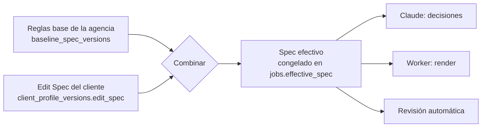
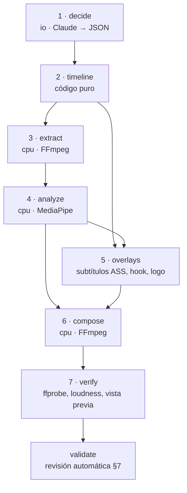

# 03 · Edit Spec, JSON de decisiones de edición y pipeline de clips

**Proyecto:** Content Engine (AEO.co) · **Fecha:** 12 de noviembre de 2026 · **Autor:** Alex Tigselema
**Fuentes:** documento de requerimientos (RF-10, RF-11, RF-13, RF-14, RF-15), `ref_client-video-editing-rules.md` (reglas base de la agencia y plantilla), `bkb_edit-spec_guidepost-marketing-real-example.md` (Edit Spec real), documentos 00 a 02.

Define cómo se guarda el Edit Spec, qué JSON devuelve Claude para cada clip y cómo el worker lo convierte en un MP4 con FFmpeg y MediaPipe. Cubre también la regeneración por aspecto, la revisión automática y los experimentos de la Fase 0.

---

## 1. Decisiones de este documento

| Tema | Decisión | Origen |
| --- | --- | --- |
| Modelo del Edit Spec | **Reglas base de la agencia + Edit Spec del cliente que las sobrescribe**, igual que el proceso actual. Las reglas base son globales, versionadas y las edita el admin | `ref_client-video-editing-rules.md`: "if a client rule says something different, the client rule wins" |
| Áreas del Edit Spec | Las 15 áreas de la plantilla de la agencia, mapeadas a los 9 bloques del requerimiento | Plantilla de la agencia; requerimiento §Perfil |
| Cada área | Parámetros que la máquina aplica + reglas en texto que lee Claude + estado `confirmed` / `to_confirm` | Los Edit Specs reales mezclan valores exactos y reglas cualitativas, y tienen campos "[To confirm]" |
| Campos sin confirmar | Usan el valor de las reglas base y se muestran como pendientes en la ficha del cliente | Guidepost tiene 8 campos "[To confirm]" |
| Gráficos animados explicativos | **Fuera de alcance.** Si un cliente los pide (Guidepost), los agrega el revisor de video | Respuesta del 12 nov; RF-10 no los incluye |
| Duración | 30 a 60 s por defecto; el cliente puede extender hasta 90 s | Respuesta del 12 nov: reglas base "under 60 s" + requerimiento "30 a 90 s" |
| Hook | Texto en pantalla con la palabra clave resaltada y, si Claude lo considera mejor, el clip arranca con una frase fuerte de más adelante del mismo momento (*cold open*) | Respuesta del 12 nov; reglas base: "open with the question or the most surprising line" |
| Origen del comentario | Cada corrección indica si es feedback del cliente (con sus palabras) o interno | Respuesta del 12 nov; change log de la agencia |
| Prioridad de reencuadre | Una persona a cámara, grabación horizontal | Respuesta del 12 nov; Guidepost: "solo to camera, records horizontally" |
| Claude y el tiempo | Claude solo referencia **índices de palabras** de la transcripción, nunca milisegundos ni píxeles | Principio "Claude decide, el worker ejecuta"; evita tiempos inventados |

---

## 2. El Edit Spec

### 2.1 Reglas base + cliente



Reglas de combinación, por área:

| Elemento | Regla |
| --- | --- |
| `params` | El valor del cliente gana por campo. Si el área del cliente está `to_confirm`, se usan los `params` base. |
| `rules` (texto) | Se juntan: primero las base, después las del cliente. Si el cliente marca una regla base como reemplazada (`overrides`), esa regla base no se envía. |
| `never_do` | Unión de base y cliente. |
| `qc_extras` | Unión. |

El trabajo guarda el resultado en `jobs.effective_spec` al crearse, junto con las dos versiones usadas. Así una pieza siempre se puede reproducir aunque después cambien las reglas.

### 2.2 Estructura

```json
{
  "schema_version": 1,
  "references": [
    { "title": "Muestra aprobada del 5 nov", "url": null, "note": "Estándar de producción" }
  ],
  "areas": {
    "captions": {
      "status": "confirmed",
      "params": { "font_asset_id": "…", "text_color": "#FF7B2A", "background": { "enabled": true, "color": "#000000" } },
      "rules": ["Grupos cortos de subtítulos", "Énfasis selectivo en las palabras que Kyle está diciendo"],
      "overrides": [],
      "evidence": "Slack, 4 nov"
    }
  },
  "never_do": [
    { "rule": "Efectos de sonido", "check": "auto" },
    { "rule": "Gráficos decorativos sin significado", "check": "manual" }
  ],
  "qc_extras": ["Comparar lado a lado con la muestra aprobada del 5 nov"]
}
```

`check` indica cómo se verifica en la revisión automática (§7): `auto` (el worker lo comprueba con datos del render), `llm` (lo revisa Claude Haiku) o `manual` (queda en la lista del operador).

### 2.3 Áreas y parámetros

La columna **Bloque** es el del requerimiento. Los valores por defecto salen de las reglas base de la agencia (short form).

| Área (plantilla de la agencia) | Bloque | `params` que aplica la máquina | Base por defecto | Lo usa |
| --- | --- | --- | --- | --- |
| `format_length` | Exportación / Ritmo | `aspect`, `min_seconds`, `max_seconds` (tope 90) | 9:16, 30–60 s | Claude, timeline |
| `hook` | Apertura y cierre | `max_seconds`, `text_on_screen`, `emphasize_keyword`, `keyword_style` (color, escala), `allow_cold_open` | 3 s, sí, sí, color de acento, sí | Claude, subtítulos |
| `pacing` | Ritmo | `visual_change_every_s` [mín, máx], `max_static_s`, `pause_max_ms`, `keep_emphasis_pauses`, `remove_fillers`, `j_cut_frames` [mín, máx], `cut_bridge` (`none`, `punch_in`) | [2, 3], 4, 500, sí, sí, [3, 5], `punch_in` | Timeline, encuadre |
| `camera_framing` | Visual | `layout` (`speaker_crop`, `fit_blur`), `keep_face_visible`, `zoom.enabled`, `zoom.max_scale`, `zoom.ease_s` [mín, máx] | `speaker_crop`, sí, sí, 1.15, [1, 2] | Encuadre |
| `captions` | Subtítulos | `font_asset_id`, `size_px`, `text_color`, `background`, `outline`, `highlight.mode` (`word`, `keywords`, `none`), `highlight.color`, `position` (`lower_third`), `max_words_per_line`, `max_lines`, `uppercase`, `animation_in` (`pop`, `fade`, `none`), `avoid_face`, `platform_safe_zone` | sans serif, tercio inferior, 1 línea, entrada pop, sin salida, zona segura | Subtítulos |
| `fonts_colors` | Marca | `font_asset_ids`, `palette` (nombre → HEX), `forbidden_fonts` | — | Subtítulos, hook, tarjeta final |
| `logo` | Marca | `asset_id`, `position`, `width_pct`, `margin_pct`, `visibility` (`always`, `none`) | `none` hasta que el cliente lo defina | Composición |
| `broll_assets` | Visual | `enabled`, `sources`, `darken_under_text` | apagado (P1) | — en el MVP |
| `music_sound` | Audio | `music.enabled`, `music.asset_ids`, `music.volume_db`, `music.ducking`, `sfx.enabled`, `sfx.max_per_minute`, `sfx.asset_ids`, `loudness_lufs`, `true_peak_db` | música sí, −22 dB con ducking; sfx sí, máx 3/min; −14 LUFS, −1 dBTP | Audio |
| `graphics_transitions` | Visual | `transitions` (`cut`, `fade`, `zoom`), `forbidden_transitions`, `emojis` | `cut`, —, no | Composición |
| `tone` | — | — (solo `rules`) | — | Claude |
| `cta_end_screen` | Apertura y cierre | `intro_asset_id`, `outro_asset_id`, `end_card.enabled`, `end_card.template_asset_id`, `end_card.text`, `end_card.seconds`, `caption_cta` | sin intro (regla base: "no intro, no greeting"), tarjeta final no, `caption_cta` "Full video in the comments" | Composición, copy |
| `templates` | Plantillas gráficas | `carousel_template_asset_id`, `quote_template_asset_id` | — | Carruseles y citas |
| `export` | Exportación | `resolution`, `fps`, `video_codec`, `audio_codec`, `max_size_mb`, `file_naming` | 1080x1920, 30, H.264, AAC, 100, `{client}_{topic}_v{n}` | Composición, verificación |
| `delivery` | — | — (solo `rules`) | — | Paquete |
| `never_do` | Prohibido | lista con `check` | — | Todo |

Ejemplo, Guidepost aplicado a este modelo: `music_sound.sfx.enabled = false` y `pacing.cut_bridge = "punch_in"` ("bridge cuts with subtle reframing"). En `captions` van Figtree, `text_color #FF7B2A` y `background.color #000000`. En `fonts_colors.forbidden_fonts` va `["Phudu"]`. `logo`, `hook` y `export.resolution` quedan `to_confirm` y usan las reglas base.

### 2.4 Lo que el MVP no aplica aunque esté en el Edit Spec

| Regla del Edit Spec | Qué pasa |
| --- | --- |
| Gráficos animados que explican (diagramas, búsquedas, tarjetas) | Fuera de alcance. Queda como regla `manual` para el revisor de video. |
| Layout con gráficos arriba y la persona abajo | Fuera de alcance (depende de los gráficos). |
| B-roll | P1. |
| Imágenes aprobadas del cliente (por ejemplo, imágenes de Kyle generadas con IA) | Llegan con el B-roll (P1). |
| Varias cámaras o pantalla dividida con dos personas (ejemplo Jamie Anne) | No en el MVP: la entrada es un solo video. Dos personas en el mismo plano sí se contemplan (§5.5). |
| Formatos de salida por plataforma (16:9, 1:1) | El requerimiento pide solo 9:16. |

---

## 3. Entradas de un clip

Cuando el worker procesa un clip, ya tiene:

| Entrada | De dónde | Contenido |
| --- | --- | --- |
| Momento | `pieces` (paso `select_moments`) | `idea`, `selection_reason`, `source_ranges` (en ms y en índices de palabra) |
| Palabras | `transcripts.words` | texto, `start_ms`, `end_ms`, hablante, confianza, y si es muletilla (*disfluency*) |
| Spec efectivo | `jobs.effective_spec` | §2 |
| Medios | `jobs.media` | resolución, fps, duración |
| Recursos | `brand_assets` | fuentes, logo, música, sfx, plantillas |
| Comentario | `corrections` | solo en regeneraciones |

La transcripción se pide a AssemblyAI con las muletillas incluidas (*disfluencies*) y con el vocabulario del cliente (nombres de marca, productos) para que se escriban bien. El vocabulario sale de `voice.glossary`, un campo nuevo del perfil, y se envía como `keyterms_prompt`. AssemblyAI no marca qué palabras son muletillas: el adaptador las marca con `is_disfluency` usando la lista del dominio de `ingest` (decisión "Muletillas y glosario" en `00`).

---

## 4. JSON de decisiones de edición

Claude recibe las palabras del momento con su índice, por ejemplo `[1203] Google [1204] stopped …`, más el spec efectivo, y devuelve un único JSON validado con `schemas/edit_decision.json`.

### 4.1 Ejemplo

```json
{
  "schema_version": 1,
  "title": "Why Google stopped sending traffic",
  "segments": [
    { "from_word": 1268, "to_word": 1281, "role": "hook" },
    { "from_word": 1203, "to_word": 1267, "role": "body" },
    { "from_word": 1282, "to_word": 1330, "role": "body" }
  ],
  "extra_cuts": [
    { "from_word": 1241, "to_word": 1246, "reason": "Repite la idea anterior" }
  ],
  "keep_pauses": [
    { "after_word": 1259, "reason": "Pausa de énfasis antes de la respuesta" }
  ],
  "hook": {
    "text": "Google isn't sending you traffic anymore",
    "keywords": ["Google"]
  },
  "emphasis": [
    { "word": 1230, "kind": "zoom" },
    { "word": 1301, "kind": "zoom" },
    { "word": 1215, "kind": "caption_keyword" },
    { "word": 1290, "kind": "caption_keyword" }
  ],
  "caption_fixes": [
    { "word": 1219, "text": "AEO" }
  ],
  "story": {
    "hook_word": 1268,
    "tension_word": 1255,
    "answer_word": 1290,
    "cta_word": null
  },
  "end_cta_text": "Full video in the comments",
  "rationale": "El hook adelanta la frase más fuerte; la tensión está en el 'but' de 1255."
}
```

### 4.2 Campos

| Campo | Qué es | Reglas de validación |
| --- | --- | --- |
| `segments` | Tramos del momento, en el orden en que se verán | Dentro del rango del momento (± 15 s de margen); sin solaparse. Como máximo un `hook`, y si existe va primero. El primer `body` puede empezar antes que el hook (*cold open*). Solo si `hook.allow_cold_open`. |
| `extra_cuts` | Partes que Claude quiere quitar además de muletillas y pausas | Dentro de algún segmento. |
| `keep_pauses` | Pausas que no se deben recortar (énfasis) | Solo si `pacing.keep_emphasis_pauses`. |
| `hook.text` | Texto del hook en pantalla | Máx. ~8 palabras. **No puede tener cifras ni nombres que no estén en la transcripción** (regla "no inventa datos"). |
| `hook.keywords` | Palabras del hook con estilo distinto | Deben estar en `hook.text`. |
| `emphasis` | Momentos de zoom y palabras resaltadas en subtítulos | Zooms con al menos 4 s de separación; cantidad acorde a `pacing`. |
| `caption_fixes` | Corrección de cómo se escribe una palabra en el subtítulo | Solo ortografía: distancia de edición pequeña o término del glosario. **No cambia lo que se dijo.** |
| `story` | Marca dónde están hook, tensión, respuesta y CTA (estructura de la agencia) | Índices dentro de los segmentos; sirve para la revisión y para explicar la elección. |
| `end_cta_text` | Texto de cierre o del copy | Viene de los CTAs aprobados del perfil o de `caption_cta`. |
| `rationale` | Por qué se armó así | Se muestra al operador. |

### 4.3 Validación y reparación

1. Validación de esquema (Pydantic).
2. Validación de reglas (tabla anterior) **y de duración**: se calcula el timeline (§5.1) y la duración final debe estar entre `min_seconds` y `max_seconds`.
3. Si algo falla, se le devuelven a Claude los errores concretos ("dura 72 s, máximo 60") para **un** intento de reparación. Si vuelve a fallar, la pieza queda `failed` con el error visible.

Claude no decide estilos (fuentes, colores, posición del logo): eso lo aplica el worker desde el spec. Así una pieza nunca puede salir con una tipografía prohibida por decisión del modelo.

---

## 5. Pipeline de render

Cada clip es un grupo de pasos en `job_steps`. En la cola, *timeline* corre dentro de `clip.extract` y *overlays* dentro de `clip.compose` (`04-worker.md` §4.1), porque son rápidos y no conviene pagar un paso aparte por ellos. Los resultados intermedios se guardan en `work/{job_id}/clips/{piece_id}/` con un hash de sus entradas, para no rehacer lo que no cambió (§6).



### 5.1 Timeline (código puro, sin red ni archivos)

Convierte el JSON de decisiones en una lista de cortes del video original y en un **mapa de tiempos** (tiempo en el original → tiempo en el clip).

1. Toma los `segments` en orden.
2. Quita las muletillas (si `remove_fillers`) y los `extra_cuts`.
3. Parte el tramo en cada pausa mayor a `pause_max_ms`, salvo las de `keep_pauses`, igual que con una muletilla. No hay una duración de pausa propia: el silencio que queda lo forman los márgenes del punto 4 (≈ 120 + 60 = 180 ms).
4. Ajusta cada corte al borde de palabra con un margen (≈ 60 ms antes, ≈ 120 ms después) para no cortar sílabas. Nunca corta en medio de una palabra.
5. Aplica *J cuts*: en cada unión, el audio del tramo siguiente entra `j_cut_frames` antes que la imagen. Se usa el valor del medio del rango, siempre el mismo (`(mín + máx) // 2`: 4 fotogramas ≈ 133 ms a 30 fps), para que el paso dé el mismo resultado al repetirse. Los cortes de audio no cambian; el timeline guarda aparte los cortes de imagen (`video_cuts`): en cada unión, la imagen del corte anterior se alarga ese tiempo y la del siguiente empieza ese tiempo después. Los cortes del medio duran lo mismo que su audio (el primero dura ese tiempo más y el último ese tiempo menos), así que la imagen suma lo mismo que el audio y no se desfasan, y el mapa de tiempos se calcula sobre el audio, que es lo que siguen los subtítulos.
6. Marca qué cortes necesitan "puente" (`cut_bridge`): en una sola cámara, un salto se disimula cambiando el encuadre (§5.3).
7. Devuelve la lista de tramos, el mapa de tiempos, la duración final y la lista de puntos de corte.

Es la parte con más lógica y la más fácil de probar: tests unitarios con transcripciones de ejemplo, sin video.

### 5.2 Extract

FFmpeg extrae cada tramo del original con búsqueda exacta y los une en un **intermedio** (`mezzanine.mp4`): resolución original, 30 fps constantes, H.264 de alta calidad (CRF 16, preset `veryfast`, `yuv420p`) y audio AAC a 48 kHz y 192 kbps. Los siguientes pasos trabajan sobre este archivo corto, no sobre el video de 1 hora.

Por los J cuts, la imagen y el audio de cada tramo tienen rangos distintos (`video_cuts` y `cuts`, §5.1). Cada rango es una entrada propia de FFmpeg con búsqueda de entrada (`-ss inicio -t duración -i original`): dos entradas por tramo, imagen y audio. **La imagen y el audio se unen por separado** (un `concat` de solo imagen y otro de solo audio): si se unieran de a pares, cada tramo duraría lo del más largo y `concat` rellenaría el otro con silencio o imagen congelada, deshaciendo el J cut. Cada tramo de imagen se lee 100 ms de más, se pasa a 30 fps y se recorta (`trim=end_frame`) a un número exacto de fotogramas, redondeado sobre el tiempo **acumulado**: el tramo k termina en el fotograma `round(fin acumulado × 30 ÷ 1000)`. Así cada corte queda a menos de medio fotograma de su lugar sin que el error se sume, aunque el original tenga otra frecuencia (24 fps, por ejemplo, donde FFmpeg solo entrega fotogramas enteros de 41,7 ms), y el camino de cámara ubica los puentes con la misma cuenta. Saltar al punto exacto evita leer el original desde el principio, como haría recortar con `trim`/`atrim` sobre una sola entrada. Los argumentos los arma una función pura del dominio del clip (`ffmpeg_args.py`); el adaptador solo ejecuta FFmpeg.

### 5.3 Analyze: encuadre

Sobre el intermedio, reducido a ~640 px de ancho:

1. **Detección de cara** con MediaPipe Face Detector, ~10 fps. Las cajas se guardan en píxeles del intermedio original, no de la imagen reducida.
2. **Pista principal:** en una persona a cámara es la cara más grande y persistente. Las caras se agrupan en pistas: una caja se une a la pista más cercana si su centro está a ≤ 0,5 anchos de cara de la última caja de esa pista y es de un fotograma anterior, sin límite de tiempo. Gana la pista con mayor suma de áreas (ancho × alto de cada caja).
3. **Ventana 9:16:** alto completo y ancho = alto × 9 ÷ 16, calculado desde la resolución real del intermedio. En un video 1920x1080 da 608x1080.
4. **Camino de cámara** (código puro, `camera_path.py`): un keyframe por fotograma del intermedio (30 fps). Entre dos cajas de cara (cada 100 ms) la posición se interpola en línea recta, salvo a través de un corte: ahí cada lado usa la caja de su plano. El centro de la ventana sigue a la cara con:
   - zona muerta: no se mueve mientras el centro de la cara esté dentro del 10 % central **del ancho de la ventana** (±30 px en 608); al salir, apunta a centrar la cara,
   - suavizado con un resorte amortiguado crítico (ω = 8, llega en ~0,6 s sin pasarse) y velocidad máxima de 600 px/s (20 px por fotograma),
   - límites para que la cara quede visible (`keep_face_visible`): se permite dejar afuera hasta un **5 % del ancho de la caja por lado**, para que el ruido de los bordes de la detección no haga temblar la ventana. Si aun así la cara no cabe, la ventana se centra en ella. Esta regla gana sobre la velocidad máxima.
5. **Zooms:** en cada `emphasis.kind = zoom`, la ventana se achica hasta `zoom.max_scale` (1.15): entrada de 1,5 s (el medio de `zoom.ease_s`), 1 s sostenido y salida de 1,5 s. En total 4 s, la separación mínima entre zooms. Las curvas usan *smoothstep* (3p² − 2p³). Los índices de palabra se pasan a tiempo del clip antes (`words_to_clip_ms` en el timeline).
6. **Puentes de corte** (`cut_bridge = punch_in`): en cada salto de imagen (`Timeline.video_cut_points_ms`), el encuadre alterna al instante entre 100 % y 110 % y la cámara salta a la cara, así el corte se lee como cambio de plano y no como salto. Con un zoom en curso: escala = base + (1,15 − base) × avance del zoom; con el zoom completo el puente no se nota. Esto también cumple el "cambio visual cada 2–3 s" de las reglas base.
7. **Sin cara** más de 2 s (por ejemplo, se sale de cuadro): se mantiene la última posición, y el camino devuelve esos tramos (todo el hueco, `no_face`) para que el render use `fit_blur` (cuadro completo centrado sobre el mismo video desenfocado). Un hueco es más de 200 ms entre dos cajas.

Ancho y alto de la ventana se redondean a números pares (`yuv420p`). El fotograma de cada corte es `round(ms × 30 ÷ 1000)`, la misma cuenta con la que el intermedio recorta sus tramos (§5.2), y hay un keyframe por fotograma real: `round(duración × 30 ÷ 1000)`.

Resultado: una lista de *keyframes* de recorte `(t, x, y, w, h)`, los tramos sin cara y la caja de la cara por tiempo, que sirve para ubicar los subtítulos (`avoid_face`) y para la revisión automática.

### 5.4 Overlays

| Elemento | Cómo |
| --- | --- |
| Subtítulos | Archivo ASS generado desde las palabras y el mapa de tiempos. Agrupa por `max_words_per_line`, puntuación y pausas. Resalta palabra por palabra o solo `caption_keyword`, según `highlight.mode`. Entrada pop (escala 80 % → 100 % en ~80 ms), sin salida. Fondo de caja si `background.enabled`. Se ubica en el tercio inferior, dentro de la zona segura de las plataformas y por debajo de la cara. |
| Hook | Capa ASS de 0 a `hook.max_seconds` con `hook.text`; las `keywords` usan `keyword_style`. |
| Logo | PNG escalado a `width_pct` × 1080 px en `position` con `margin_pct`. |
| Tarjeta final | Si `end_card.enabled`: PNG renderizado con Playwright desde la plantilla del cliente (mismo motor que carruseles). |
| Fuentes | Las del cliente se copian a una carpeta de fuentes del render; si falta una, el paso falla (no cae en una fuente por defecto). |

### 5.5 Dos personas en el mismo plano

No es la prioridad de la Fase 0, pero el diseño lo contempla. Con dos caras en cuadro, se asocia cada hablante de AssemblyAI a una cara: se compara el movimiento de la boca (MediaPipe Face Landmarker) con los tramos en que habla cada hablante, y la ventana sigue al hablante activo. Se valida cuando llegue un video así.

### 5.6 Compose

Un solo comando FFmpeg con `filter_complex`:

- **Video:** intermedio → recorte que cambia en el tiempo con los keyframes de §5.3 → escala a 1080x1920 → subtítulos y hook (ASS) → logo → tarjeta final → intro y outro si existen.
- **Audio:** voz normalizada a `loudness_lufs` (−14 LUFS, dos pasadas) + música en bucle a `volume_db` con *ducking* (baja cuando hay voz) + sfx en los puntos marcados, si están permitidos.
- **Salida:** H.264 High, `yuv420p`, 30 fps, AAC 48 kHz, `+faststart`. Si supera `max_size_mb`, se recodifica a una tasa objetivo.

El recorte variable se hace con comandos de tiempo de FFmpeg (`sendcmd` sobre el filtro `crop`). **Se valida en la Fase 0**. Si no queda fluido, el plan B es recortar cuadro por cuadro en Python (PyAV) y pasar los cuadros a FFmpeg: más lento pero con control total.

### 5.7 Verify

- `ffprobe`: resolución, fps, códecs, duración dentro del rango, audio presente.
- Decodificación completa sin errores y detección de cuadros congelados.
- Loudness medido (−14 LUFS ± 1).
- Detección de silencios largos que no estén en `keep_pauses`.
- Genera una vista previa liviana (540x960) para revisar en el celular (RNF-07) y una imagen de portada.

---

## 6. Regenerar por aspecto (RF-13) y editar subtítulos (RF-14)

Cada paso guarda su resultado con el hash de sus entradas; una regeneración solo rehace lo que cambia.

| Pedido | Pasos que se rehacen | Tiempo estimado |
| --- | --- | --- |
| Hook (comentario) | decide (solo hook) → timeline si cambia el cold open → overlays → compose → verify | 1–3 min |
| Texto de subtítulos (edición manual, RF-14) | overlays → compose → verify | ~1–2 min |
| Estilo de subtítulos (cambio del spec) | overlays → compose → verify | ~1–2 min |
| Ritmo o cortes (comentario) | decide → timeline → extract → analyze → overlays → compose → verify | 2–4 min |
| Encuadre (comentario) | analyze (con parámetros ajustados) → compose → verify | 1–3 min |
| Todo | todos | 2–4 min |

Todos quedan dentro de "un clip, menos de 5 minutos" (RNF-02). El comentario del operador llega a Claude junto con el JSON anterior, y Claude devuelve el JSON completo corregido. Así cada versión es autosuficiente.

---

## 7. Revisión automática (RF-11)

La agencia ya tiene un checklist antes de enviar (Pass 1 del editor y Pass 2 del CM). La herramienta automatiza lo que se puede medir:

| Ítem del checklist de la agencia | Cómo se verifica | Tipo |
| --- | --- | --- |
| El archivo se reproduce entero, sin cortes ni congelados | Decodificación completa + detección de congelados | auto |
| Exportación igual al spec (ratio, resolución, fps, audio, nombre) | `ffprobe` + loudness | auto |
| Logo con el tamaño y la posición del spec | Lo coloca el render con los valores del spec; se registra en el plan | auto |
| Subtítulos sin errores | El texto sale de la transcripción; los `caption_fixes` se validan; Haiku revisa nombres propios contra el glosario | auto + llm |
| Subtítulos no tapados por los botones de la plataforma | Posición dentro de la zona segura | auto |
| Subtítulos sincronizados | Tiempos tomados de las palabras a través del mapa de tiempos | auto |
| Subtítulos que no tapan la cara | Caja de subtítulos vs caja de la cara | auto |
| Fuentes y colores del cliente | El plan de render solo usa fuentes y colores del spec; `forbidden_fonts` | auto |
| Hook en los primeros 3 s | Validación del JSON | auto |
| Ritmo: sin silencios largos ni planos estáticos largos | Detección de silencios + intervalo entre cambios de encuadre ≤ `max_static_s` | auto |
| Se cumple cada regla del change log | Haiku compara las reglas en texto con el resumen del plan de render | llm |
| No aparece nada de "Never do" | Según `check` de cada regla | auto / llm / manual |
| Verlo en el celular, compararlo con la referencia, "¿lo publicaría hoy?" | El operador en la pantalla de revisión | manual |

El resultado va a `piece_versions.validation` con la lista de problemas. Las reglas `manual` aparecen como una lista de verificación en la tarjeta del clip.

---

## 8. Archivos intermedios

```
work/{job_id}/clips/{piece_id}/
  decision.{hash}.json
  timeline.{hash}.json
  mezzanine.{hash}.mp4
  analysis.{hash}.json          # caras + keyframes de recorte
  captions.{hash}.ass
  overlays.{hash}/              # logo escalado, tarjeta final
pieces/{job_id}/{piece_id}/v{n}/
  clip.mp4
  preview.mp4                   # 540x960
  poster.jpg
```

`work/` se borra con la retención del original (RNF-06). La versión final queda en `pieces/`.

---

## 9. Rendimiento estimado (clip de 60 s, 8 núcleos)

| Paso | Estimado |
| --- | --- |
| decide (Claude) | 15–40 s |
| timeline | < 1 s |
| extract | 10–20 s |
| analyze | 10–20 s |
| overlays | < 5 s |
| compose (incluye loudness en dos pasadas) | 50–100 s |
| verify | 10–15 s |
| **Total** | **~2–3 min por clip**; 6 clips con 3 en paralelo ≈ 5–8 min |

Se mide en la Fase 0.

---

## 10. Fase 0 (1 semana)

**Objetivo:** demostrar con videos reales que el pipeline propio produce clips aceptables antes de construir la app.

**Material:** una grabación propia del mismo tipo que los videos de Guidepost (una persona a cámara, grabación horizontal, en inglés) y el Edit Spec de Guidepost. La agencia no puede compartir videos de clientes por ahora (`00-resumen-decisiones.md`, "Material de prueba").

**Forma:** un script de línea de comandos en el worker, sin base de datos ni web: `python -m content_engine.clips.prototype video.mp4 spec.json decision.json`. La transcripción se pide una vez a AssemblyAI y se guarda en un archivo.

| # | Experimento | Criterio de éxito |
| --- | --- | --- |
| 1 | Timeline con muletillas, pausas y J cuts | Ningún corte se come una sílaba; los cortes no se notan al escucharlos |
| 2 | Encuadre 16:9 → 9:16 con MediaPipe | La cara siempre completa; sin temblores; movimiento casi imperceptible en plano fijo |
| 3 | Zooms y puentes de corte con recorte variable (`sendcmd`) | Movimiento fluido; si no, se prueba el plan B (PyAV) |
| 4 | Subtítulos ASS en Figtree, naranja sobre negro, resaltado por palabra | Sincronía a simple vista; nunca sobre la cara |
| 5 | Audio a −14 LUFS, sin sfx (Guidepost) | Medido con FFmpeg |
| 6 | JSON de decisiones con Claude sobre 3 momentos reales | JSON válido sin intervención; hook dentro de 3 s; duración en rango |
| 7 | Tiempo por clip | ≤ 3 min en la máquina del desarrollador |

**Entregable:** 3 clips de un mismo video, comparados lado a lado con la muestra aprobada del 5 nov, más un informe corto de tiempos y problemas. Los gráficos explicativos no se esperan (fuera de alcance).

---

## 11. Riesgos

| Riesgo | Impacto | Mitigación |
| --- | --- | --- |
| Clientes como Guidepost dependen de gráficos animados (fuera de alcance) | Para ellos el revisor de video no se podrá apagar y no llegarán a la meta de 90 % de clips sin editor | Avisar a la agencia ahora; medir la meta solo en clientes sin esa regla |
| Recorte variable con `sendcmd` no fluido | Zooms y encuadre bruscos | Plan B con PyAV, validado en la Fase 0 |
| "Cambio visual cada 2–3 s" con una sola cámara se vuelve repetitivo | Clips monótonos | Alternar puentes de corte y zooms; ajustar con la muestra aprobada |
| Edit Specs con muchos campos "[To confirm]" | El resultado no coincide con lo que el cliente espera | Usar reglas base y mostrar los pendientes en la ficha del cliente |
| Nombres de marca mal transcritos | Subtítulos con errores | Glosario del cliente a AssemblyAI + revisión con Haiku |
| Dos personas o varias cámaras | Encuadre incorrecto | Fuera de la prioridad de la Fase 0; §5.5 para el mismo plano |

---

## 12. Cambios en otros documentos

- `02-modelo-de-datos.md`: tabla `baseline_spec_versions`, columnas `jobs.baseline_version_id` y `jobs.effective_spec`, `corrections.origin` y `corrections.client_quote`, tipo de recurso `sfx`, campo `voice.glossary`, y `edit_spec` con la estructura de §2.2.
- `00-resumen-decisiones.md`: decisiones de §1.
