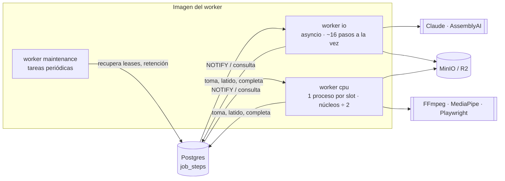
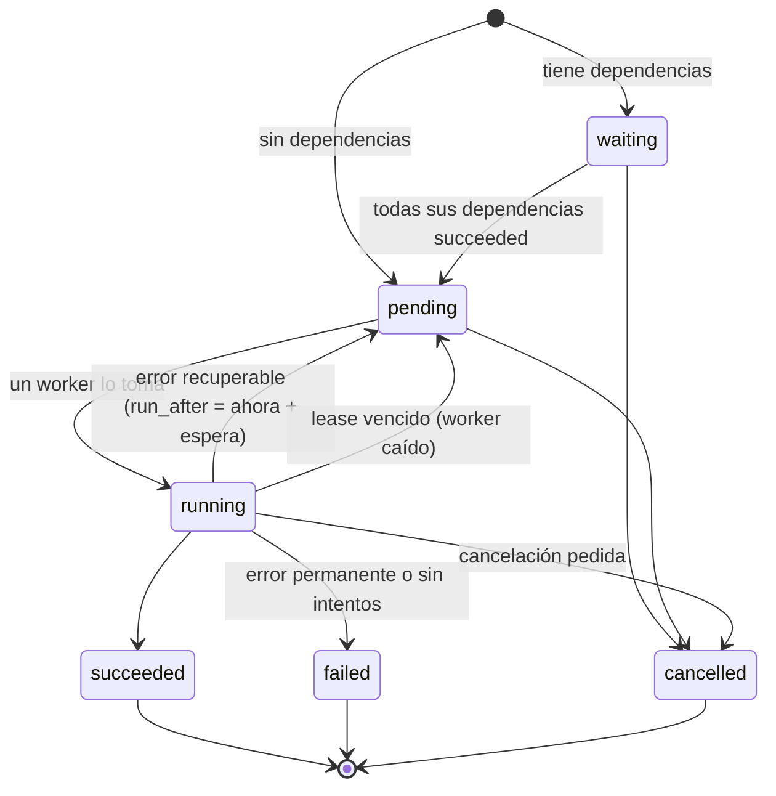

# 04 · Diseño del worker en Python

**Proyecto:** Content Engine (AEO.co) · **Fecha:** 12 de noviembre de 2026 · **Autor:** Alex Tigselema
**Fuentes:** documento de requerimientos (RF-13, RF-21, RNF-01, RNF-02, RNF-03, RNF-05, RNF-06), documentos 00 a 03.

Define cómo el worker toma trabajo de la cola, en qué orden ejecuta los pasos, cómo reintenta, qué estados cambia y cómo se recupera si se cae. La tabla `job_steps` está en `02-modelo-de-datos.md` §4.6 y los pasos de clips en `03-edicion-de-clips.md` §5.

---

## 1. Decisiones de este documento

| Tema | Decisión | Motivo |
| --- | --- | --- |
| Cola | Tabla `job_steps` en Postgres, tomada con `FOR UPDATE SKIP LOCKED` | Ya decidido en la arquitectura; sin Redis |
| Dependencias | Un paso nace `waiting` si tiene dependencias y pasa a `pending` cuando todas terminan bien | El orquestador solo busca pasos `pending`, la consulta es simple y rápida |
| Grafo dinámico | El grafo empieza con 4 pasos; `select_moments` agrega los pasos de cada pieza al terminar | Las piezas se conocen recién al elegir momentos |
| Aviso de trabajo nuevo | Por eventos con `LISTEN/NOTIFY` de Postgres; un temporizador despierta al worker justo cuando vence el próximo reintento; revisión de seguridad cada 60 s. Sin sondeo corto | Respuesta inmediata (RNF-02) sin consultas constantes |
| Prioridad | Regeneraciones con prioridad alta | El operador está esperando frente a la pantalla |
| Caídas | Lease con latido; si vence, otro worker retoma el paso | RNF-03: el trabajo no se pierde |
| Reintentos | Automáticos con espera exponencial, solo para errores recuperables | RNF-03 |
| Quién cambia estados | El worker hace las transiciones automáticas; las funciones `rpc` de la web, las humanas. Son conjuntos separados | Evita que dos partes del código apliquen la misma regla distinto |
| Tope de costo | Se revisa antes de cada llamada externa; si se supera, el trabajo pasa a `paused_budget` | RNF-05 |
| Procesos | Una sola imagen Docker con tres comandos: `worker io`, `worker cpu`, `worker maintenance` | Escalar cada tipo por separado (arquitectura §2.3) |

---

## 2. Procesos



| Proceso | Qué toma | Concurrencia | Notas |
| --- | --- | --- | --- |
| `worker io` | Pasos de la cola `io`: llamadas a Claude y AssemblyAI, descargas | Un proceso con `asyncio`, hasta ~16 pasos a la vez, con un límite por proveedor (§8) | Casi no usa CPU |
| `worker cpu` | Pasos de la cola `cpu`: FFmpeg, MediaPipe, Playwright, ZIP | Un proceso por slot; slots = núcleos ÷ 2 | Cada slot hace un paso a la vez; FFmpeg ya usa varios hilos |
| `worker maintenance` | Nada de la cola | Uno solo | Recupera leases vencidos, aplica la retención, detecta trabajos trabados y, en la Fase 3, despacha eventos |

En local, `docker-compose.yml` levanta los tres servicios con la misma imagen. En el MVP todo corre en la misma máquina, así el original descargado se comparte entre pasos por disco (§10).

---

## 3. La cola

### 3.1 Estados de un paso



Si un paso falla, sus dependientes en `waiting` pasan a `cancelled`. La pieza o el trabajo quedan `failed` según §6.

### 3.2 Tomar un paso

```sql
with next as (
  select s.id
  from job_steps s
  join jobs j on j.id = s.job_id
  where s.queue = $1
    and s.status = 'pending'
    and s.run_after <= now()
    and j.status in ('processing', 'in_review', 'delivering')   -- excluye pausados y cancelados
  order by s.priority desc, s.created_at
  for update of s skip locked
  limit 1
)
update job_steps s
set status       = 'running',
    attempts     = s.attempts + 1,
    locked_by    = $2,                          -- id del worker: host + pid + slot
    locked_until = now() + make_interval(secs => $3),
    started_at   = coalesce(s.started_at, now())
from next
where s.id = next.id
returning s.*;
```

- `skip locked` hace que dos workers nunca tomen el mismo paso y que no se bloqueen entre sí.
- `in_review` está en la lista porque las regeneraciones ocurren mientras el trabajo está en revisión.
- Índice: `(queue, priority desc, created_at) where status = 'pending'`.

### 3.3 Despertar a los workers

El worker no pregunta cada pocos segundos si hay trabajo: **Postgres le avisa**. Es el mismo modelo que un WebSocket (una conexión abierta por la que llegan los avisos), pero entre el worker y la base de datos, con `LISTEN/NOTIFY`.

1. **Aviso de trabajo nuevo.** Un trigger en `job_steps` hace `pg_notify('steps_' || queue, '')` cuando un paso queda `pending`. Cada worker mantiene una conexión escuchando su canal; al recibir el aviso, toma pasos hasta que no quede ninguno y vuelve a esperar.
2. **Reintentos programados.** Un paso que espera un reintento (`run_after` en el futuro) no genera ningún evento cuando llega su hora. Por eso, al quedarse sin trabajo, el worker consulta el `run_after` más cercano de su cola y programa un temporizador exactamente para ese momento. Si no hay ninguno, no programa nada.
3. **Revisión de seguridad cada 60 s.** `NOTIFY` no se guarda: si el worker estaba desconectado o reiniciándose cuando llegó el aviso, lo pierde. Al reconectarse revisa la cola de inmediato y, además, cada 60 s hace una consulta de respaldo por si algo se escapó. Es una consulta sobre un índice parcial y tarda alrededor de 1 ms.

Nota de Supabase: `LISTEN` necesita una conexión directa o el pooler en modo sesión; el pooler en modo transacción no lo soporta. El worker usa una conexión dedicada para escuchar y otra para trabajar.

Supabase Realtime (también WebSockets) no se usa en el worker: está pensado para el navegador y tampoco guarda los eventos perdidos, así que necesitaría el mismo respaldo.

### 3.4 Lease y latido

| Cola | Lease | Latido |
| --- | --- | --- |
| `io` | 2 min | cada 30 s |
| `cpu` | 5 min | cada 60 s |

Mientras un paso corre, el worker extiende `locked_until` con cada latido. Si el worker se cae, el latido para; `worker maintenance` encuentra el paso `running` con el lease vencido y lo devuelve a `pending` (o a `failed` si ya no tiene intentos). El latido también revisa si se pidió cancelar (§7.3).

### 3.5 Completar un paso

En **una sola transacción**:

1. Guarda `output`, `finished_at` y `status = 'succeeded'`, solo si `locked_by` sigue siendo este worker. Si otro worker lo retomó, se descarta.
2. Aplica las transiciones de pieza o trabajo que correspondan (§6).
3. Inserta los pasos nuevos si el paso expande el grafo (§4.2).
4. Libera a los dependientes: los `waiting` cuyas dependencias terminaron todas pasan a `pending`.

```sql
update job_steps d
set status = 'pending'
where d.status = 'waiting'
  and $1 = any(d.depends_on)
  and not exists (
    select 1 from job_steps x
    where x.id = any(d.depends_on) and x.status <> 'succeeded'
  );
```

Los archivos (MP4, PNG, JSON) se suben **antes** de la transacción, con claves deterministas. Si la transacción falla, el reintento sobrescribe los mismos archivos, sin duplicar.

---

## 4. Pasos y grafo

### 4.1 Catálogo de pasos

| Paso | Cola | Hace | Intentos | Tiempo máx. | Fase |
| --- | --- | --- | --- | --- | --- |
| `fetch_source` | io | Descarga un link (YouTube, Zoom, Loom) al almacenamiento | 3 | 30 min | P1 |
| `probe` | cpu | Descarga el original al disco local si falta; `ffprobe`; reglas de RF-05 | 3 | 5 min | 1 |
| `extract_audio` | cpu | Audio mono 16 kHz a `work/` | 3 | 10 min | 1 |
| `transcribe` | io | Envía a AssemblyAI con muletillas y glosario; espera el resultado; normaliza a `transcripts` | 3 | 30 min | 1 |
| `select_moments` | io | Claude elige momentos; crea `pieces` y **expande el grafo** | 3 | 5 min | 1 |
| `text.generate` | io | Post, blog o newsletter | 3 | 3 min | 1 |
| `quote.generate` | io | Elige la frase textual y escribe el copy | 3 | 2 min | 2 |
| `quote.render` | cpu | Plantilla → PNG con Playwright | 3 | 3 min | 2 |
| `carousel.generate` | io | Contenido de slides + copy | 3 | 3 min | 2 |
| `carousel.render` | cpu | Plantilla → PNG por slide + PDF | 3 | 5 min | 2 |
| `clip.decide` | io | JSON de decisiones + copy del post (doc 03 §4) | 3 | 3 min | 2 |
| `clip.extract` | cpu | Timeline + intermedio (doc 03 §5.1–5.2) | 3 | 10 min | 2 |
| `clip.analyze` | cpu | Caras y keyframes de recorte (doc 03 §5.3) | 3 | 10 min | 2 |
| `clip.compose` | cpu | Overlays + render final (doc 03 §5.4–5.6) | 2 | 15 min | 2 |
| `clip.verify` | cpu | Verificación y vista previa (doc 03 §5.7) | 2 | 5 min | 2 |
| `validate` | io | Revisión automática de la pieza (verificación de citas en la Fase 1; completa en la Fase 3) | 3 | 3 min | 1 / 3 |
| `deliver` | cpu | Arma el ZIP ordenado por formato y crea el link compartible | 3 | 15 min | 1 |
| `notify` | io | ClickUp y Slack | 5 | 1 min | 3 |
| `edit_spec.import` | io | Documento → propuesta de perfil (RF-03) | 3 | 5 min | 3 |
| `corrections.match` | io | Compara una corrección nueva con las reglas aceptadas | 3 | 1 min | 3 |

Los nombres de pasos son los mismos en `job_steps.step_type` y en el registro del código (§5).

### 4.2 Grafo de un trabajo

Al completar la subida, `complete_upload` crea los cuatro primeros pasos:

```
probe → extract_audio → transcribe → select_moments
```

Cuando `select_moments` termina, en la misma transacción crea las piezas según el mix y sus cadenas de pasos. El **planificador** es una función pura (`pipeline/domain/planner.py`): recibe el mix y el registro de tipos de pieza, y devuelve los pasos con sus dependencias.

| Tipo de pieza | Cadena |
| --- | --- |
| `post`, `blog`, `newsletter` | `text.generate → validate` |
| `quote` | `quote.generate → quote.render → validate` |
| `carousel` | `carousel.generate → carousel.render → validate` |
| `clip` | `clip.decide → clip.extract → clip.analyze → clip.compose → clip.verify → validate` |

En la Fase 1 solo existen las cadenas de texto; el planificador ignora los tipos aún no registrados y la UI los muestra como "no disponible en esta fase".

Prioridades: los pasos de texto van antes que los de clips, para que el operador empiece a revisar texto mientras los clips renderizan.

| Prioridad | Uso |
| --- | --- |
| 100 | Regeneraciones y re-render pedidos por una persona |
| 50 | Pasos de texto y validaciones |
| 10 | Pasos de render (clips, carruseles, citas) |
| 0 | Mantenimiento |

### 4.3 Entrega

`deliver_job` (rpc) cambia el trabajo a `delivering` y crea el paso `deliver`. Cuando termina, el trabajo pasa a `delivered` y, en la Fase 3, se crea `notify`.

---

## 5. Contrato de un paso en el código

```python
class StepHandler(Protocol):
    step_type: ClassVar[str]          # "clip.compose"
    queue: ClassVar[Queue]            # Queue.CPU
    max_attempts: ClassVar[int]       # 2
    timeout_s: ClassVar[int]          # 900
    input_model: ClassVar[type[BaseModel]]
    output_model: ClassVar[type[BaseModel]]

    async def run(self, ctx: StepContext, inp: BaseModel) -> StepResult: ...
```

`StepResult` contiene la salida (`output`) y, opcionalmente, los pasos nuevos que hay que crear (solo `select_moments` lo usa).

`StepContext` le da al paso todo lo que necesita, sin que el paso sepa de dónde viene:

| Atributo | Qué es |
| --- | --- |
| `job`, `piece` | Datos del trabajo y la pieza (incluye `effective_spec`) |
| `storage` | Adaptador S3 (MinIO / R2) |
| `llm`, `transcriber` | Adaptadores de Claude y AssemblyAI |
| `budget` | `ensure(estimate_usd)` y `record(usage)` (§8) |
| `workdir` | Carpeta local temporal del trabajo |
| `heartbeat()` | Lo llaman los pasos largos; también detecta cancelación |
| `log` | Logger con `job_id`, `piece_id`, `step_id` ya puestos |

Los handlers se registran en un diccionario `step_type → handler`. Agregar un tipo de pieza es agregar sus handlers y su cadena al registro (arquitectura §2.5).

Reglas para escribir un paso:

1. **Idempotente:** si corre dos veces con la misma entrada, deja el mismo resultado.
2. **No escribe estados:** devuelve el resultado y el orquestador hace las transiciones (§3.5).
3. **Valida entrada y salida** con sus modelos Pydantic.
4. **Lanza el error del tipo correcto** (§6.1).

---

## 6. Errores, reintentos y estados

### 6.1 Tipos de error

| Error | Ejemplos | Qué pasa |
| --- | --- | --- |
| `RetryableError` | Timeout, error de red, 5xx, 429, `ffmpeg` cortado por falta de memoria | Vuelve a `pending` con `run_after = ahora + espera`. Si es 429 y el proveedor indica cuánto esperar, se respeta |
| `PermanentError` | Archivo corrupto, video sin audio, más de 2 h, JSON inválido después de la reparación, fuente faltante, intermedio con un número de fotogramas distinto al del timeline (`03` §5.2) | `failed` sin reintentar |
| `NeedsConfirmation` | Calidad dudosa en `probe` (RF-05) | El paso termina bien; el trabajo pasa a `needs_confirmation` y los dependientes esperan |
| `BudgetExceeded` | Se superaría el tope del trabajo | El paso vuelve a `pending` sin gastar un intento; el trabajo pasa a `paused_budget` |
| Cualquier otro | Error de programación | Se trata como recuperable una vez; si se repite, `failed`, y queda en logs y Sentry |

Espera entre intentos: 30 s, 2 min, 8 min (± 20 % aleatorio para no reintentar todos a la vez). El mensaje de `last_error` es legible para el operador ("AssemblyAI no respondió; se reintentará en 2 min"); el detalle técnico va a los logs.

### 6.2 Qué pasa cuando un paso falla del todo

| Paso que falla | Efecto |
| --- | --- |
| `fetch_source`, `probe`, `extract_audio`, `transcribe`, `select_moments` | El trabajo pasa a `failed`. El operador ve el motivo y puede reintentar el trabajo (rpc `retry_job`) |
| Cualquier paso de una pieza | Solo esa pieza pasa a `failed`; las demás siguen. La tarjeta muestra el error y un botón para reintentar (rpc `retry_piece`) |
| `deliver` | El trabajo vuelve a `in_review` con el error visible (arquitectura §5.1) |
| `notify` | No afecta al trabajo; queda registrado |

### 6.3 Transiciones automáticas (worker)

| Evento | Pieza | Trabajo |
| --- | --- | --- |
| `probe` empieza | — | `queued → processing` |
| `probe` con calidad dudosa | — | `processing → needs_confirmation` |
| `select_moments` termina | se crean en `pending` | — |
| Primer paso de una pieza empieza | `pending → generating` | — |
| Último paso antes de `validate` termina | `generating → validating` | — |
| `validate` termina, clip con revisor activo | `validating → in_video_review` | — |
| `validate` termina, otro caso | `validating → ready` | — |
| Todas las piezas en estado final (`ready`, `in_video_review`, `failed`) | — | `processing → in_review` y se llena `ready_for_review_at` |
| `deliver` termina | — | `delivering → delivered` y se llena `delivered_at` |
| Tope superado | — | `→ paused_budget` |

Las transiciones humanas (aprobar, comentar, regenerar, pasar revisión de video, confirmar calidad, enviar, cancelar) las hacen las funciones `rpc` de `02-modelo-de-datos.md` §5.3. Cada transición, de un lado u otro, se escribe como `update … where status = <estado esperado>`; si no actualiza ninguna fila, alguien cambió el estado antes y la operación se descarta sin romper nada.

---

## 7. Regenerar, reintentar y cancelar

### 7.1 Regenerar una pieza (RF-13, RF-14)

1. La rpc `add_comment(..., regenerate = true)` o `save_manual_edit` crea la versión nueva en `generating` y los pasos del aspecto pedido (tabla de `03-edicion-de-clips.md` §6) con prioridad 100, en una transacción.
2. Si ya había una regeneración en curso para esa pieza, sus pasos se cancelan: solo vale la última.
3. La versión anterior sigue visible hasta que la nueva está lista.
4. Al terminar, `pieces.current_version_id` apunta a la nueva versión y la pieza vuelve a `ready`, o a `in_video_review` si es un clip con revisor.

### 7.2 Reintentar

- `retry_piece`: crea de nuevo la cadena de la pieza desde el primer paso que falló. Los resultados intermedios ya guardados se reutilizan por su hash (doc 03 §6).
- `retry_job`: crea de nuevo los pasos desde el que falló.

### 7.3 Cancelar

`cancel_job` (rpc, operador o admin) llena `jobs.cancel_requested_at` y pasa los pasos `waiting` y `pending` a `cancelled`. Los pasos que están corriendo lo detectan en el siguiente latido y se detienen (FFmpeg se termina con su proceso). Cuando no queda ninguno corriendo, el trabajo pasa a `cancelled`.

---

## 8. Costos y límites de proveedores

**Tope por video (RNF-05):**

1. Antes de llamar a Claude o AssemblyAI, el paso llama `ctx.budget.ensure(estimado)`. Suma `cost_events` del trabajo y el estimado; si pasa `jobs.cost_cap_usd`, lanza `BudgetExceeded`.
2. Después de la llamada, `ctx.budget.record(uso)` inserta en `cost_events` de inmediato, en su propia transacción. El gasto ocurrió aunque el paso falle después.
3. Con el trabajo en `paused_budget`, la consulta de §3.2 no toma sus pasos. El admin sube el tope (rpc `resume_job`) y el trabajo sigue donde quedó.

**Límites por proveedor:** en `worker io`, un semáforo por proveedor (por ejemplo, Claude 8 llamadas a la vez y AssemblyAI 5), configurables por variable de entorno. Si en el futuro hay varios procesos `io`, el límite pasa a la base de datos.

**Caché de prompts:** las piezas de un mismo trabajo comparten el bloque fijo (perfil, spec efectivo, transcripción). Se envía primero y marcado para caché; el costo leído y escrito en caché se registra en `cost_events`.

---

## 9. Mantenimiento

| Tarea | Cada | Qué hace |
| --- | --- | --- |
| Recuperar leases | 30 s | `running` con `locked_until` vencido → `pending` o `failed` |
| Trabajos trabados | 5 min | Avisa (log + Sentry) si un trabajo lleva más de 60 min en `processing` desde `upload_completed_at` (RNF-01) |
| Retención | diaria | Borra `originals/` y `work/` de trabajos más antiguos que `source_retention_days` y llena `source_deleted_at` (RNF-06) |
| Disco local | 1 h | Borra de `/tmp/ce` los trabajos terminados y aplica un tope de espacio |
| Eventos | 10 s | Despacha `outbox_events` (Fase 3) |

---

## 10. Archivos locales

- Cada trabajo usa `/tmp/ce/{job_id}/`. El original se descarga una sola vez (en `probe`) y los pasos siguientes lo leen de ahí.
- Si el archivo no está (otra máquina, disco limpiado), el paso lo vuelve a descargar. Por eso ningún paso depende de que el disco local se conserve.
- En despliegue con varias máquinas, la lectura por rangos desde R2 queda pendiente de validar (arquitectura §8.3).

---

## 11. Observabilidad

- **Logs** en JSON, con `job_id`, `piece_id`, `step_id`, `step_type`, intento y duración.
- **`job_steps`** es el registro de auditoría: cuánto tardó cada paso, cuántos intentos hizo, el último error.
- **Tiempos de RNF-01 y RNF-02:** se calculan desde `job_steps` (de `upload_completed_at` a `ready_for_review_at`; duración de las regeneraciones).
- **Sentry** en despliegue, para errores no esperados.

---

## 12. Pruebas

| Nivel | Qué se prueba | Cómo |
| --- | --- | --- |
| Unitario | Planificador, transiciones, clasificación de errores, espera entre intentos, timeline de clips | Funciones puras, sin base de datos |
| Integración (Supabase local) | Dos workers no toman el mismo paso; lease vencido se recupera; dependencias se liberan; pausa por tope; cancelación | `pytest` contra `supabase start` |
| Pasos | Cada handler con adaptadores falsos (Claude y AssemblyAI con respuestas grabadas) | Sin red ni costo |
| Extremo a extremo | Video corto de prueba (2–3 min) de punta a punta | Manual o en CI nocturno; usa las APIs reales |

---

## 13. Por fase

| Fase | Del worker |
| --- | --- |
| 0 | Sin cola: script de línea de comandos para clips (doc 03 §10) |
| 1 | `worker io` + `worker cpu` (probe, audio, entrega), `worker maintenance`; pasos de texto, validación de citas, entrega; reintentos, leases, tope de costo |
| 2 | Pasos de clips, carruseles y citas; revisor de video |
| 3 | `notify`, `edit_spec.import`, `corrections.match`, validación completa con Haiku, varios videos en paralelo medidos (RF-21) |
| 4 | Despliegue (Trigger.dev o VPS), retención, ajustes con datos reales |

---

## 14. Cambios en otros documentos

- `02-modelo-de-datos.md`: `step_status` suma `waiting`; `job_steps` suma `priority`; `jobs` suma `cancel_requested_at`; nuevas rpc `retry_job`, `retry_piece`, `cancel_job`, `resume_job`.
