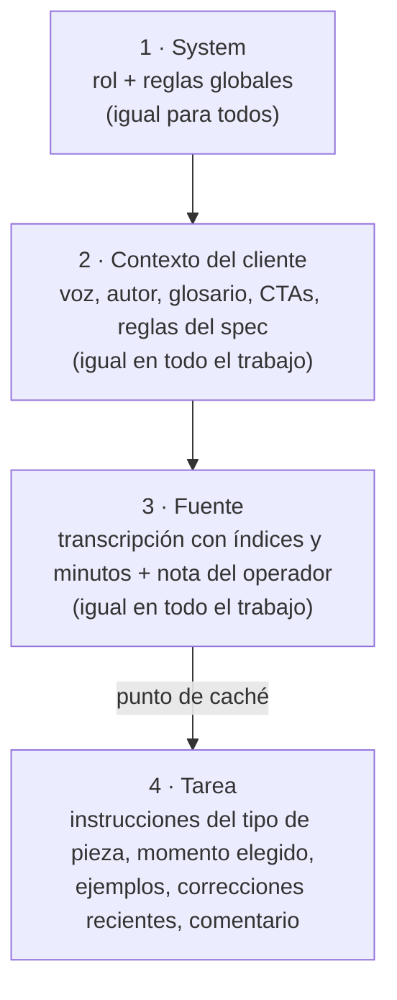

# 05 · Prompts de Claude

**Proyecto:** Content Engine (AEO.co) · **Fecha:** 13 de noviembre de 2026 · **Autor:** Alex Tigselema
**Fuentes:** documento de requerimientos (RF-07, RF-08, RF-09, RF-11, RF-13, RF-17, reglas para todas las piezas, RNF-08, RNF-10), documentos 00 a 04, `materials/`.

Define qué recibe Claude en cada paso, qué devuelve, cómo se evita que invente datos, cómo aprende de las correcciones y cómo se versionan y prueban los prompts. Los textos completos de los prompts viven en `worker/prompts/`; aquí van su estructura, sus reglas y un ejemplo.

---

## 1. Decisiones de este documento

| Tema | Decisión | Origen |
| --- | --- | --- |
| Formato del blog AEO y la newsletter | **Supuesto:** se usa lo que dice el requerimiento (blog: TL;DR, subtítulos como preguntas con respuesta directa, FAQ, schema FAQPage, bio del autor; newsletter: 3 asuntos, preheader, cuerpo y CTA). Se ajusta cuando la agencia entregue su formato | El formato real no está en `materials/`; pregunta sin respuesta el 13 nov |
| Autor | Campo `voice.author` en el perfil: nombre, cargo, bio corta y foto. Se usa en blog, newsletter y gráficos de cita | Respuesta del 13 nov |
| Memoria de correcciones | Cada prompt recibe las reglas aceptadas (ya dentro del spec), las **últimas 10 correcciones** del mismo tipo de pieza para ese cliente y hasta **3 ejemplos** marcados por el admin | Respuesta del 13 nov; RF-17 |
| Salida | Siempre JSON validado con un esquema (salidas estructuradas de la API). Los modelos Pydantic del worker son la única fuente de los esquemas | Requerimiento: "salidas estructuradas en JSON" |
| HTML, Markdown y schema | **No los escribe Claude.** Claude devuelve contenido estructurado y el worker lo convierte con plantillas en Markdown, HTML (Shopify o WordPress) y JSON-LD de FAQPage | HTML válido siempre; el schema no puede tener errores de sintaxis |
| Idioma | Prompts en inglés; salida en `clients.output_language` (normalmente `en-US`) | La salida es en inglés de EE. UU.; un prompt en el mismo idioma reduce mezclas |
| Modelos | Sonnet para elegir y generar; Haiku para validar y comparar. IDs en variables de entorno | Resumen de decisiones |
| Versionado | Cada prompt es un archivo con versión; cada paso registra qué prompt y qué modelo usó | RNF-10: "cómo editar los prompts" |

---

## 2. Estructura común de un prompt

Todos los pasos arman el mensaje en el mismo orden. Lo que menos cambia va primero, para aprovechar la **caché de prompts**: las 20 piezas de un trabajo comparten el mismo inicio y solo pagan completo lo que cambia.



| Bloque | Contenido | Cambia |
| --- | --- | --- |
| 1. System | Rol ("senior content strategist and editor for AEO.co"), reglas globales (§2.1), formato de salida | Nunca (por versión de prompt) |
| 2. Cliente | `voice` completo (negocio, oferta, cliente ideal, tono, palabras y temas prohibidos, frases preferidas, CTAs), `author`, `glossary`, reglas en texto del spec efectivo y `never_do` | Por trabajo |
| 3. Fuente | Transcripción en párrafos con hablante, minuto e índices de palabras; nota del operador | Por trabajo |
| 4. Tarea | Instrucciones del tipo de pieza, el momento, ejemplos, correcciones, y en regeneraciones la versión anterior y el comentario | Por pieza |

El punto de caché va al final del bloque 3. La caché dura 5 minutos por defecto y se renueva con cada uso; las piezas de un trabajo se generan dentro de esa ventana. Las lecturas de caché se registran aparte en `cost_events`.

### 2.1 Reglas globales (bloque 1)

Resumen de lo que dice el system prompt; el texto exacto está en `worker/prompts/_shared/system.md`:

1. **No inventes.** Ninguna cifra, porcentaje, fecha, nombre, resultado ni promesa que no esté en la fuente o en el perfil del cliente. Si falta un dato, escribe sin él.
2. **Cita tu origen.** Cada pieza indica los rangos de palabras de los que salió (`source_ranges`) y cada afirmación concreta lleva su rango (`claims`, §4).
3. **Respeta la voz.** Usa el tono del perfil; nunca uses palabras ni temas prohibidos; usa solo los CTAs aprobados con sus links.
4. **Idioma de salida:** el del cliente.
5. **Solo JSON** con el esquema indicado.

### 2.2 Formato de la transcripción (bloque 3)

```
[00:12:04 · A · w1180–w1231] So the first thing most brands get wrong is they still write for ten blue links…
[00:12:31 · A · w1232–w1290] But here's the thing: Google isn't sending you that traffic anymore…
```

Cada párrafo lleva minuto, hablante e índices de palabras. Claude responde con índices (`w1232`) y el worker los traduce a tiempos. Para un video de 1 hora son unos 15.000 tokens.

---

## 3. Catálogo de prompts

| Prompt | Paso | Modelo | Devuelve | Fase |
| --- | --- | --- | --- | --- |
| `select_moments` | `select_moments` | Sonnet | Momentos e ideas de las 20 piezas | 1 |
| `post` | `text.generate` | Sonnet | Post por plataforma | 1 |
| `blog` | `text.generate` | Sonnet | Blog AEO estructurado | 1 |
| `newsletter` | `text.generate` | Sonnet | Newsletter estructurada | 1 |
| `quote` | `quote.generate` | Sonnet | Rango de la frase + copy | 2 |
| `carousel` | `carousel.generate` | Sonnet | Slides + copy | 2 |
| `clip_decide` | `clip.decide` | Sonnet | JSON de decisiones de edición + copy | 2 |
| `validate` | `validate` | Haiku | Problemas encontrados | 1 (citas) / 3 |
| `edit_spec_import` | `edit_spec.import` | Sonnet | Propuesta de perfil y Edit Spec | 3 |
| `correction_match` | `corrections.match` | Haiku | Regla aceptada que se repite, o ninguna | 3 |
| `rule_propose` | mantenimiento | Sonnet | Reglas nuevas propuestas | 3 |

Las regeneraciones (RF-13) usan el mismo prompt de su tipo con un bloque extra (§3.9).

### 3.1 `select_moments` (RF-07)

**Recibe:** bloques 1–3, el mix del trabajo, las reglas de `format_length` y `hook` del spec, y los temas de los últimos 3 trabajos del cliente (para no repetir entre semanas; opcional).

**Instrucciones clave:**

- Una idea distinta por pieza: **nunca dos piezas con el mismo tema** (RF-07). Blog y newsletter pueden cubrir el video completo, con ángulos distintos entre sí.
- Por tipo de pieza:
  - **Clips:** tramo que se entiende solo y dura entre `min_seconds` y `max_seconds`, con una frase que funcione como hook y la estructura de la agencia (hook, tensión, respuesta).
  - **Carruseles:** contenido que se pueda contar en pasos, listas o marcos.
  - **Citas:** frases textuales de 8 a 25 palabras, que se sostengan solas.
  - **Posts:** un ángulo concreto cada uno.
- La razón de cada elección (RF-07), en una o dos frases.
- La nota del operador manda sobre las preferencias generales ("enfócate en el lanzamiento de diciembre").

**Devuelve:**

```json
{
  "pieces": [
    {
      "piece_type": "clip",
      "slot": 1,
      "theme_key": "google-traffic-drop",
      "idea": "Google no te manda tráfico como antes y eso cambia qué escribir",
      "angle": "Contrarian",
      "reason": "Frase fuerte, ejemplo concreto y cierre claro en 48 s",
      "ranges": [{ "from_word": 1203, "to_word": 1330 }],
      "hook_candidate_word": 1268
    }
  ]
}
```

**Validación del worker:** cantidad por tipo igual al mix; `theme_key` sin repetir; rangos existentes; clips con duración en rango (±15 s, el ajuste fino es de `clip_decide`); citas con largo en rango. Si falla, un intento de reparación con los errores (como en el documento 03 §4.3).

### 3.2 `post` (RF-08)

**Recibe:** bloques 1–3, el momento, la plataforma (`clients.post_platforms`, rotando entre las del cliente), ejemplos y correcciones de `post`.

**Reglas por plataforma** (en el prompt, ajustables por cliente):

| Plataforma | Estructura |
| --- | --- |
| LinkedIn | Hook en la primera línea (antes del "ver más"), párrafos cortos, CTA, 3–5 hashtags; hasta ~1.300 caracteres |
| Facebook | Hook, cuerpo conversacional, CTA, 1–3 hashtags |
| X | Un post de hasta 280 caracteres o un hilo de hasta 5 posts si el cliente lo permite; 1–2 hashtags |

**Devuelve:** `platform`, `hook`, `body`, `cta` (`text`, `url`), `hashtags`, `source_ranges`, `claims`.

### 3.3 `blog` (RF-08, formato supuesto)

**Recibe:** bloques 1–3, el momento o ángulo del blog, `author`, `blog_platform`, ejemplos y correcciones de `blog`.

**Estructura pedida:**

1. Título (≤ 65 caracteres) y meta descripción (≤ 155).
2. **TL;DR** de 2–4 frases.
3. Secciones con **subtítulo en forma de pregunta** y **respuesta directa en las primeras 40–60 palabras**, luego el desarrollo.
4. **FAQ** de 4–6 preguntas con respuestas de 2–4 frases.
5. CTA aprobado.
6. Bio del autor (de `voice.author`, sin reescribir).
7. Total de **1.200 a 2.000 palabras**.

**Devuelve** contenido estructurado, no HTML:

```json
{
  "title": "…",
  "meta_description": "…",
  "slug": "…",
  "tldr": "…",
  "sections": [{ "question": "…", "direct_answer": "…", "body_markdown": "…" }],
  "faq": [{ "question": "…", "answer": "…" }],
  "cta": { "text": "…", "url": "…" },
  "source_ranges": [],
  "claims": []
}
```

El worker arma con plantillas:

- **Markdown:** el texto del blog.
- **HTML:** según `blog_platform`, listo para pegar en Shopify o WordPress.
- **JSON-LD `FAQPage`:** sale de `faq`, sin intervención de Claude.

También valida que el largo esté entre 1.200 y 2.000 palabras; si no, un intento de reparación.

### 3.4 `newsletter` (RF-08, formato supuesto)

**Devuelve:** `subject_lines` (exactamente 3, ≤ 60 caracteres), `preheader` (≤ 100), `greeting`, `body_sections` (Markdown), `cta`, `signature` (del autor), `source_ranges`, `claims`. El worker genera el texto plano y el HTML con la plantilla de newsletter.

### 3.5 `quote` (RF-09)

Claude **no escribe la cita**: elige el rango de palabras. El texto se toma tal cual de la transcripción, con limpieza mínima: quitar muletillas y corregir mayúsculas.

**Devuelve:** `quote_range` (`from_word`, `to_word`), `attribution` (nombre y cargo del autor o del hablante), `copy` (post que acompaña la imagen), `source_ranges`.

**Validación:** 8–25 palabras; el rango es una frase completa (empieza y termina en límite de oración); sin cifras sueltas fuera de contexto.

### 3.6 `carousel` (RF-09)

**Recibe** además los límites de la plantilla del cliente: caracteres máximos por título y cuerpo, número de slides.

**Devuelve:** `slides` (6 a 10; la primera es la portada con el hook y la última el CTA), cada una con `title` y `body`; `copy` del post; `source_ranges`; `claims`. El worker revisa los límites de caracteres antes de renderizar; si una slide no entra, un intento de reparación.

### 3.7 `clip_decide` (RF-10)

Definido en `03-edicion-de-clips.md` §4. **Recibe** las palabras del momento con índice, las muletillas marcadas y las pausas en milisegundos, además de las reglas de `hook`, `pacing`, `format_length`, `tone` y `never_do`. **Devuelve** el JSON de decisiones más el `copy` del post del clip.

### 3.8 `validate` (RF-11)

Antes de Haiku corren las comprobaciones deterministas (§4 y documento 03 §7). Haiku revisa solo lo que requiere juicio:

**Recibe:** el contenido de la pieza (texto o resumen del plan de render), las reglas del spec marcadas `llm`, las palabras y temas prohibidos, el tono, y las correcciones recientes del tipo de pieza (para detectar si se repite un error ya corregido).

**Devuelve:**

```json
{
  "passed": false,
  "issues": [
    {
      "rule": "No exclamation marks (change log 2026-11-04)",
      "severity": "error",
      "location": "body, línea 3",
      "explanation": "Usa dos signos de exclamación"
    }
  ]
}
```

Con `severity = error` la pieza se marca en la tarjeta del operador; no se regenera sola en el MVP. En la Fase 1 solo corre la verificación de cifras y citas; Haiku entra en la Fase 3.

### 3.9 Regeneración (RF-13)

Se agrega al bloque 4 del prompt del tipo de pieza:

```
<previous_version> …JSON de la versión anterior… </previous_version>
<operator_comment aspect="hook" origin="client"> "Too salesy. Lead with the question." </operator_comment>
Change only what the comment asks. Keep everything else identical. Return the full JSON.
```

Así la versión nueva cambia solo lo pedido y sigue siendo completa (documento 03 §6).

### 3.10 Fase 3: importar, comparar y proponer reglas

| Prompt | Recibe | Devuelve |
| --- | --- | --- |
| `edit_spec_import` (RF-03) | Texto del documento del cliente (PDF, DOCX o Google Doc) + estructura del Edit Spec + reglas base | `voice` y `edit_spec` con cada área en `confirmed` (si el documento lo dice) o `to_confirm`, y la cita del documento como `evidence`. El admin confirma |
| `correction_match` | Una corrección nueva + reglas aceptadas del cliente | `rule_id` que se repite o `null`, con una frase de explicación. Llena `corrections.matched_rule_id` |
| `rule_propose` | Correcciones del cliente sin regla todavía (últimos 30 días) | Grupos de correcciones similares (2 o más) con una regla propuesta: `rule_text`, `target_block`, `proposed_patch`. Crea `rule_proposals` |

---

## 4. Que ninguna pieza invente datos

El requerimiento dice: "ninguna pieza inventa datos, cifras ni promesas que el cliente no dijo en la fuente". Se cubre en tres capas:

| Capa | Qué hace | Fase |
| --- | --- | --- |
| 1. Instrucción | Regla global 1 del system prompt (§2.1) | 1 |
| 2. Afirmaciones con origen | Cada pieza devuelve `claims`: `[{ "text": "60% of searches end without a click", "from_word": 1240, "to_word": 1252 }]` para toda cifra, dato, nombre o promesa | 1 |
| 3. Verificación determinista | El worker extrae del texto final las cifras, porcentajes, montos y fechas, y comprueba que **cada uno aparezca en la transcripción o en el perfil** (normalizando "sixty percent" = "60%"). Las citas se comparan palabra por palabra. Si algo no aparece, la pieza queda marcada con error | 1 |
| 4. Verificación con Haiku | Para cada `claim`, Haiku confirma que el rango de la transcripción lo respalda | 3 |

"Cada pieza indica de qué minuto del video salió": `source_ranges` se convierte a minutos y se muestra en la tarjeta (RF-12).

---

## 5. Memoria de correcciones y ejemplos

En el bloque 4, para el tipo de pieza que se genera:

```
<client_examples piece_type="post">
  <example note="Tono directo, sin hype">…</example>          ← hasta 3, marcados por el admin
</client_examples>
<recent_corrections piece_type="post">
  - 2026-11-04 · client: "No exclamation marks, it feels like an ad" → removed exclamation marks
  - 2026-11-02 · internal: "CTA must link to /apply" → changed CTA url
</recent_corrections>                                         ← últimas 10
```

- Las **reglas aceptadas** no se repiten aquí: ya están en el spec efectivo (bloque 2).
- Las correcciones que ya se convirtieron en regla se omiten de esta lista.
- Ejemplos y correcciones van en el bloque 4, fuera de la caché, porque son por tipo de pieza.

---

## 6. Archivos de prompts y versionado

```
worker/prompts/
├── _shared/
│   ├── system.md
│   ├── client_context.md.j2
│   └── source.md.j2
├── select_moments.md.j2
├── post.md.j2
├── blog.md.j2
├── newsletter.md.j2
├── quote.md.j2
├── carousel.md.j2
├── clip_decide.md.j2
├── validate.md.j2
├── regenerate_block.md.j2
├── edit_spec_import.md.j2
├── correction_match.md.j2
└── rule_propose.md.j2
```

Cada archivo empieza con un encabezado:

```yaml
---
id: post
version: 3
model_role: generate        # generate | validate
max_tokens: 2000
temperature: 0.7
output_schema: PostOutput   # modelo Pydantic
---
```

- Plantillas Jinja2; las variables vienen de modelos Pydantic, no de diccionarios sueltos.
- Cada paso guarda en `piece_versions.generation` el `prompt_id@version`, el modelo usado y los tokens. Así se sabe con qué prompt salió cada pieza.
- **Cómo editar un prompt (RNF-10):** cambiar el archivo, subir `version`, correr la evaluación (§7) y comparar contra la versión anterior antes de desplegar.

---

## 7. Evaluación de prompts

Un set pequeño y fijo, en `worker/evals/`:

- 2 o 3 transcripciones reales (Guidepost y otro cliente), con su perfil y spec.
- Un script que corre cada prompt y mide:
  - % de salidas válidas al primer intento,
  - % que pasan la verificación de cifras y citas,
  - temas repetidos en `select_moments`,
  - duración de clips en rango,
  - largo del blog en rango,
  - tokens y costo.
- Una hoja de revisión manual con 5 piezas por tipo, para el criterio humano.

Se corre antes de cambiar un prompt o un modelo. Los resultados se guardan en `worker/evals/results/` con la fecha y la versión.

---

## 8. Tokens estimados por video (1 hora, 20 piezas)

| Paso | Llamadas | Entrada nueva (aprox.) | Entrada en caché (aprox.) | Salida (aprox.) | Modelo |
| --- | --- | --- | --- | --- | --- |
| `select_moments` | 1 | 20k (escribe la caché) | — | 3k | Sonnet |
| Posts | 6 | 6 × 2k | 6 × 19k | 6 × 0,6k | Sonnet |
| Blog | 1 | 3k | 19k | 3,5k | Sonnet |
| Newsletter | 1 | 2k | 19k | 1,5k | Sonnet |
| Carruseles | 4 | 4 × 2k | 4 × 19k | 4 × 1k | Sonnet |
| Citas | 2 | 2 × 1,5k | 2 × 19k | 2 × 0,4k | Sonnet |
| Clips | 6 | 6 × 4k | 6 × 19k | 6 × 1,2k | Sonnet |
| Reparaciones (~15 %) | ~3 | ~10k | ~57k | ~3k | Sonnet |
| Validación | 20 | 20 × 3k | — | 20 × 0,3k | Haiku |
| **Total Sonnet** | | **~80k** | **~440k** | **~32k** | |
| **Total Haiku** | | **~60k** | — | **~6k** | |

El costo en USD sale de multiplicar por los precios vigentes de cada modelo, que van en la tabla de precios de la configuración (`04-worker.md` §8). La caché hace que las ~440k de entrada repetida cuesten una fracción del precio normal. El tope por video protege contra un caso fuera de lo normal.

---

## 9. Cambios en otros documentos

- `02-modelo-de-datos.md`: `voice.author` (nombre, cargo, bio, foto) y `piece_versions.generation` (prompt, versión, modelo, tokens).
- `00-resumen-decisiones.md`: decisiones de §1.
