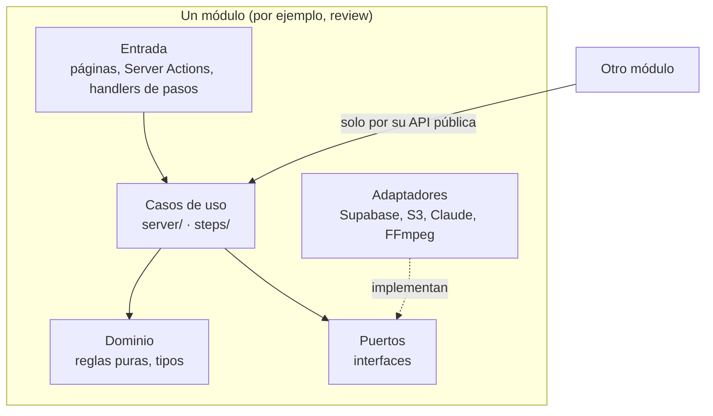
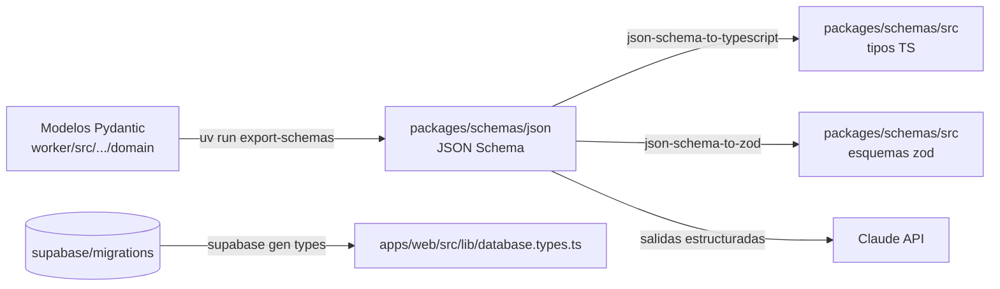

# 06 · Arquitectura del código

**Proyecto:** Content Engine (AEO.co) · **Fecha:** 13 de noviembre de 2026 · **Autor:** Alex Tigselema
**Fuentes:** `01-arquitectura.md` §2, documentos 02 a 05.

Define cómo se organiza el código: el estilo, las carpetas, qué puede importar qué, las convenciones, cómo se prueba cada capa y cómo se agrega un tipo de pieza nuevo. Este documento manda sobre el árbol resumido de `01-arquitectura.md`.

---

## 1. Decisiones de este documento

| Tema | Decisión | Origen |
| --- | --- | --- |
| Estilo | **Monolito modular por dominio + hexagonal dentro de cada módulo** | `01-arquitectura.md` §2.1 |
| Monorepo | pnpm workspaces (TypeScript) + uv (Python) en un solo repo, sin Turborepo ni Nx | Respuesta del 13 nov |
| UI | Tailwind + shadcn/ui | Respuesta del 13 nov |
| Datos en la web | Server Components para la carga inicial; TanStack Query en el cliente, actualizado por Supabase Realtime | Respuesta del 13 nov |
| Escrituras desde la web | Server Actions que llaman funciones `rpc`; Route Handlers solo para lo que no es un formulario (firmar subidas, link público) | `02-modelo-de-datos.md` §5.3 |
| Acceso a datos | Sin ORM: supabase-js con tipos generados; psycopg + Pydantic en el worker | Resumen de decisiones |
| Contratos compartidos | Los modelos Pydantic del worker son la fuente; se exportan a JSON Schema y de ahí a tipos de TypeScript y esquemas zod | Una sola definición para Claude, worker y web |
| Reglas de dependencia | Se verifican en CI: dependency-cruiser (TypeScript) e import-linter (Python) | Que la arquitectura no se degrade con el tiempo |
| Calidad | TypeScript estricto + ESLint + Prettier; Ruff (lint y formato, con las reglas `D` que exigen docstrings) + Pyright en modo estricto | Herramientas estándar de cada lenguaje |
| Docstrings | Estilo Google en Python y TSDoc en TypeScript; los escribe solo el agente `documentador` y Ruff los exige en el worker (§9.1) | Cada función se entiende sin leer su código, con el mismo estilo en todo el repo |
| Pruebas | Vitest y Playwright (e2e) en la web; pytest en el worker; pgTAP para SQL, RLS y `rpc` | §8 |

---

## 2. El estilo en tres reglas



1. **Por dominio:** el código se agrupa por lo que hace en el negocio (`clients`, `jobs`, `review`, `delivery`…), no por tipo de archivo (`controllers/`, `services/`). Todo lo de "revisión" está junto.
2. **Hexagonal dentro de cada módulo:** el dominio no conoce la base de datos, la red ni FFmpeg. Los casos de uso hablan con el exterior a través de **puertos** (interfaces) y los **adaptadores** los implementan.
3. **Los módulos se hablan solo por su API pública** (`index.ts` en la web, `api.py` en el worker). Nadie entra a las carpetas internas de otro módulo ni lee sus tablas directamente.

---

## 3. Árbol del monorepo

```
aeo-content-engine/
├── apps/
│   └── web/                         # Next.js (§4)
├── worker/                          # Python (§5)
├── packages/
│   └── schemas/                     # contratos generados (§7)
│       ├── json/                    #   JSON Schema exportado desde Pydantic
│       └── src/                     #   tipos TS + esquemas zod generados
├── supabase/
│   ├── migrations/                  # esquema, RLS, funciones rpc (SQL)
│   ├── tests/                       # pgTAP: RLS y rpc
│   └── seed.sql                     # usuarios de prueba, cliente demo, reglas base
├── templates/                       # plantillas HTML base: carrusel, cita, tarjeta final, blog, newsletter
├── materials/                       # material de la agencia (no se despliega)
├── docs/
├── .github/workflows/ci.yml
├── docker-compose.yml               # MinIO + worker io / cpu / maintenance
├── package.json                     # scripts de la raíz (§10)
├── pnpm-workspace.yaml              # apps/*, packages/*
└── .env.example
```

---

## 4. Web (Next.js)

### 4.1 Carpetas

```
apps/web/src/
├── app/                             # SOLO rutas y composición
│   ├── (auth)/login/page.tsx
│   ├── (app)/
│   │   ├── layout.tsx               # sesión, navegación por rol
│   │   ├── jobs/
│   │   │   ├── new/page.tsx         # subir video
│   │   │   └── [jobId]/review/page.tsx
│   │   ├── clients/[clientId]/
│   │   │   ├── page.tsx             # historial (RF-19)
│   │   │   └── spec/page.tsx        # perfil y Edit Spec (admin)
│   │   └── admin/                   # usuarios, reglas base, métricas
│   ├── p/[token]/page.tsx           # link compartible público
│   └── api/
│       ├── uploads/route.ts         # iniciar, firmar partes y completar multipart
│       └── shares/[token]/route.ts  # descargas del link público
├── modules/
│   ├── auth/
│   ├── clients/
│   ├── jobs/                        # subida y estado del trabajo (ingest + pipeline en la web)
│   ├── pieces/
│   ├── review/
│   ├── delivery/
│   └── usage/
├── components/ui/                   # shadcn/ui (generados, editables)
└── lib/
    ├── supabase/                    # server.ts, browser.ts, middleware.ts
    ├── storage/                     # firma de URLs S3 (MinIO / R2)
    ├── query/                       # QueryClient y provider de TanStack Query
    └── database.types.ts            # generado: supabase gen types
```

### 4.2 Dentro de un módulo

```
modules/review/
├── index.ts          # API pública: lo único que otros importan
├── domain/           # puro: reglas y tipos (p. ej., ¿se puede enviar este trabajo?)
├── server/           # 'server-only'
│   ├── queries.ts    # lecturas con el cliente de Supabase del usuario (RLS)
│   └── actions.ts    # Server Actions → supabase.rpc(...)
├── hooks/            # cliente: useQuery + suscripción Realtime
└── ui/               # componentes del módulo (PieceCard, CommentBox, ApproveButton)
```

| Capa | Puede importar | No puede importar |
| --- | --- | --- |
| `app/` | `modules/*/index`, `components/ui`, `lib` | Carpetas internas de un módulo |
| `modules/x/ui`, `hooks` | `x/domain`, `x/server/actions` (Server Actions), `components/ui`, `lib/query`, `lib/supabase/browser` | `x/server/queries`, otros módulos internos |
| `modules/x/server` | `x/domain`, `lib/supabase/server`, `lib/storage`, `index` de otros módulos | Código de cliente |
| `modules/x/domain` | Solo `packages/schemas` y utilidades puras | Supabase, Next.js, React |
| `lib/` | Paquetes externos | `modules/` |

Los archivos de `server/` empiezan con `import 'server-only'`: si un componente de cliente los importa, el build falla.

### 4.3 Lecturas y tiempo real

1. La página (Server Component) llama a `queries.ts` y pasa los datos iniciales al componente cliente.
2. El componente usa `useQuery` con esos datos como valor inicial (`initialData`).
3. Un hook del módulo (`useJobRealtime(jobId)`) se suscribe a Supabase Realtime y, cuando cambia `jobs`, `pieces` o `piece_versions`, actualiza o invalida la consulta de TanStack Query.

Así la pantalla de revisión se actualiza sola sin recargar.

### 4.4 Escrituras

- Formularios y botones → **Server Action** del módulo → `supabase.rpc('approve_piece', …)` con la sesión del usuario → la función SQL valida rol, asignación y estado.
- Las Server Actions validan la entrada con zod (esquemas de `packages/schemas`) antes de llamar a la `rpc`.
- Crear cuentas (`auth.admin.createUser`) es una Server Action del módulo `auth` que usa la clave `service_role`, solo después de verificar que quien llama es admin.

---

## 5. Worker (Python)

### 5.1 Carpetas

```
worker/
├── pyproject.toml
├── models/                           # modelos de ML versionados: blaze_face_short_range.tflite
├── prompts/                          # 05-prompts.md §6
├── evals/                            # 05-prompts.md §7
├── scripts/                          # herramientas de desarrollo fuera del paquete (p. ej. plot_camera_path.py)
├── tests/
│   ├── unit/
│   ├── integration/                  # contra Supabase y MinIO locales; render con FFmpeg real (test_compose_render.py)
│   ├── fixtures/                     # transcripciones, video corto de prueba
│   └── e2e/
└── src/content_engine/
    ├── main.py                       # CLI: comandos de desarrollo por paso (cut, camera-path, compose, verify-clip…), prototype (T2.7) y worker io | cpu | maintenance (Sprint 4)
    ├── bootstrap.py                  # raíz de composición: arma adaptadores y contexto
    ├── config.py                     # pydantic-settings (variables de entorno)
    ├── shared/                       # núcleo compartido: ids, errores, tiempo, Money, transcript (Word, Transcript)
    ├── ports/                        # interfaces (Protocol)
    │   ├── llm.py  transcription.py  storage.py  media.py  repositories.py
    ├── orchestrator/                 # entrada: escucha, toma, latido, completa, registro de pasos
    ├── modules/
    │   ├── clients/      { api.py, domain/ }           # spec efectivo (reglas base + cliente), perfil
    │   ├── ingest/       { api.py, domain/, steps/ }   # probe, extract_audio, transcribe
    │   ├── pipeline/     { api.py, domain/ }           # planificador, transiciones, reintentos
    │   ├── pieces/       { api.py, domain/, steps/ }   # select_moments, verificación de claims, validate
    │   ├── review/       { api.py, domain/, steps/ }   # Fase 3: corrections.match, rule_propose
    │   ├── delivery/     { api.py, domain/, steps/ }   # deliver, estructura del ZIP
    │   ├── usage/        { api.py, domain/ }           # presupuesto, tabla de precios
    │   └── integrations/ { api.py, steps/ }            # Fase 3: notify (ClickUp, Slack), outbox
    ├── piece_types/                  # un paquete por tipo de pieza (plugins)
    │   ├── registry.py
    │   ├── post/  blog/  newsletter/  quote/  carousel/
    │   └── clip/
    │       ├── steps/                # decide, extract, analyze, compose, verify
    │       └── domain/               # timeline, faces, camera_path, sendcmd, path_checks, verify, captions_ass, render_plan, ffmpeg_args
    └── adapters/
        ├── db/                       # psycopg: repositorios y la cola
        ├── llm/anthropic.py
        ├── transcription/assemblyai.py
        ├── storage/s3.py
        └── media/                    # ffmpeg.py, clip_probe.py, mediapipe_faces.py (pyright basic), face_preview.py, playwright_render.py
```

### 5.2 Reglas de dependencia

| Capa | Puede importar | No puede importar |
| --- | --- | --- |
| `*/domain` | `shared`, `pydantic`, biblioteca estándar, el `domain` de su propio módulo | `ports`, `adapters`, `psycopg`, `anthropic`, `boto3`, `subprocess` |
| `*/steps` | Su `domain`, `ports`, `api.py` de otros módulos | `adapters` |
| `adapters` | `ports`, `shared`, tipos de `domain` | `steps`, `orchestrator` |
| `orchestrator` | `ports`, `modules/*/api`, `piece_types/registry` | `adapters` (los recibe de `bootstrap`) |
| `bootstrap.py` | Todo | — |

**Qué entra a `shared`.** Solo lo que cumple las tres condiciones: (1) lo usan dos o más módulos, (2) son datos, sin reglas de negocio de un módulo, y (3) cambia poco. Ejemplo: `shared/transcript.py` tiene `Word` y `Transcript` porque la transcripción con índices de palabra es el idioma común de `ingest`, `clip` y las demás piezas; en cambio, la lista de muletillas (`is_filler_word`) se queda en `modules/ingest/domain`, porque decidir qué es una muletilla es una regla de `ingest`.

Ejemplo de puerto y adaptador:

```python
# ports/media.py
class VideoComposer(Protocol):
    def compose(self, plan: RenderPlan, workdir: Path) -> Path: ...

# piece_types/clip/domain/render_plan.py  (puro: se prueba sin FFmpeg)
def build_render_plan(timeline: Timeline, camera: CameraPath, spec: EffectiveSpec) -> RenderPlan: ...

# adapters/media/ffmpeg.py
class FfmpegComposer(VideoComposer):
    def compose(self, plan: RenderPlan, workdir: Path) -> Path:
        args = ffmpeg_args(plan)          # función pura del dominio del clip
        run(["ffmpeg", *args], timeout=…)
```

Lo importante del clip (timeline, camino de cámara, subtítulos, plan de render, argumentos de FFmpeg) es **dominio puro**. Solo ejecutar FFmpeg es un adaptador.

### 5.3 Verificación automática

`import-linter` con contratos en `pyproject.toml`:

- **Capas:** puntos de entrada (`main`, `orchestrator`, `bootstrap`) → `adapters` → `modules` / `piece_types` → `ports` → `shared`. Una capa solo importa las de abajo: así un paso o un dominio nunca importa un adaptador. Las capas que todavía no existen (`orchestrator`, `bootstrap`, `ports`) van entre paréntesis en el contrato y se comprueban desde que se crean.
- **Prohibido:** `*.domain` no importa `psycopg`, `anthropic`, `assemblyai`, `boto3`, `mediapipe`, `playwright`, `subprocess`, `cv2` (OpenCV lee video), `content_engine.adapters`, `content_engine.config` ni `content_engine.main`.
- **Independencia:** los módulos solo se importan entre sí a través de `api.py`. Mientras no exista ningún `api.py` la excepción no avisa (`unmatched_ignore_imports_alerting = "none"`).

Se corre con `uv run lint-imports` (en `worker/`), dentro de `pnpm lint` y en el CI. Comprobado el 25 nov 2026: un `import subprocess` en un dominio rompe el contrato y el informe muestra la cadena de imports.

En la web, `.dependency-cruiser.cjs` aplica las reglas de §4.2.

---

## 6. Dos recorridos de ejemplo

**Aprobar una pieza (web):**

```
ApproveButton (modules/review/ui)
  → approvePiece()            Server Action, modules/review/server/actions.ts (valida con zod)
  → supabase.rpc('approve_piece')     con la sesión del usuario
  → approve_piece()           función SQL en supabase/migrations (rol, asignación, estado)
  → UPDATE pieces             Realtime emite el cambio
  → useJobRealtime            actualiza TanStack Query → la tarjeta cambia a "Aprobada"
```

**Renderizar un clip (worker):**

```
orchestrator: aviso en steps_cpu → toma el paso clip.compose
  → registry → piece_types/clip/steps/compose.py (caso de uso)
      → domain/captions_ass.py   (puro) subtítulos
      → domain/render_plan.py    (puro) plan
      → ctx.composer.compose()   (puerto) → adapters/media/ffmpeg.py
      → ctx.storage.put()        (puerto) → adapters/storage/s3.py
  → orchestrator: completa el paso en una transacción (04-worker.md §3.5)
```

---

## 7. Contratos compartidos y tipos generados



| Contrato | Fuente | Lo usan |
| --- | --- | --- |
| Edit Spec, `voice` | Pydantic (`modules/clients/domain/spec.py`) | Formulario del Edit Spec (zod), worker, prompts |
| JSON de decisiones de edición | Pydantic (`piece_types/clip/domain/decision.py`) | Claude, worker, vista del clip |
| Contenido de cada tipo de pieza | Pydantic (`piece_types/*/domain/content.py`) | Claude, worker, tarjetas de revisión |
| Tablas y funciones `rpc` | Migraciones SQL | Web (`database.types.ts`) |

Los archivos generados se guardan en el repo. CI los vuelve a generar y falla si hay diferencias: así nadie cambia un contrato en un lado y se olvida del otro.

---

## 8. Pruebas por capa

| Capa | Herramienta | Qué se prueba | Dónde |
| --- | --- | --- | --- |
| Dominio del worker | pytest | Planificador, transiciones, timeline, camino de cámara, ASS, plan de render, argumentos de FFmpeg, verificación de cifras | `worker/tests/unit` |
| Pasos del worker | pytest + adaptadores falsos | Cada handler con respuestas grabadas de Claude y AssemblyAI | `worker/tests/unit` |
| Cola y repositorios | pytest + Supabase local | Toma sin duplicados, leases, dependencias, tope de costo | `worker/tests/integration` |
| Render | pytest + FFmpeg real | Video de prueba de 20 s → `ffprobe` (resolución, duración, loudness) | `worker/tests/integration` |
| SQL, RLS y `rpc` | pgTAP | Cada rol ve solo lo suyo; transiciones válidas e inválidas | `supabase/tests` |
| Dominio de la web | Vitest | Reglas puras (vista previa del spec combinado, diferencias entre versiones) | junto al módulo |
| Componentes | Vitest + Testing Library | Solo los de lógica no trivial (tarjeta de pieza, editor de subtítulos) | junto al módulo |
| Extremo a extremo | Playwright | Login, subir un video corto, revisar, aprobar, enviar | `apps/web/e2e` |
| Prompts | evals | `05-prompts.md` §7 | `worker/evals` |

**Prioridad:** las pruebas de dominio del worker y las de RLS son las que más valen, porque cubren la lógica del clip y la seguridad. Los componentes de UI se prueban poco.

---

## 9. Convenciones

| Tema | Convención |
| --- | --- |
| Nombres | TypeScript: `camelCase`, componentes `PascalCase`, archivos `kebab-case.ts`. Python: `snake_case`. SQL: `snake_case`; funciones `rpc` como verbo + objeto (`approve_piece`) |
| Pasos | `modulo.accion` o `tipo.accion` (`clip.compose`), igual en código y en `job_steps.step_type` |
| Errores | Worker: `RetryableError`, `PermanentError`, `BudgetExceeded`, `NeedsConfirmation` (`04-worker.md` §6.1). Web: las Server Actions devuelven `{ ok, data }` o `{ ok: false, error }` con un mensaje legible, nunca lanzan al cliente |
| Logs | JSON con `job_id`, `piece_id`, `step_id`. Nunca claves ni contenido de clientes completo |
| Configuración | Solo por variables de entorno; `.env.example` en la raíz con todas, documentadas. Un único `.env` en la raíz: el worker lo lee como `../.env` con pydantic-settings (un `worker/.env` opcional lo sobrescribe) y se detiene con un mensaje claro si falta una clave |
| Fechas | `timestamptz` en UTC en la base; se muestran en la zona del usuario |
| Textos de la UI | En inglés (RNF-07), centralizados por módulo para cambiarlos fácil |
| Idioma del código | Todo en inglés: nombres, comentarios, archivos de configuración (`.gitignore`, `.env.example`), mensajes de commit y de log. Los documentos de `docs/` siguen en español |
| Docstrings | Todo módulo, clase y función lleva docstring en inglés: qué hace, argumentos, qué devuelve, errores que lanza y un ejemplo con números si hay una fórmula. Estilo Google en Python y TSDoc en TypeScript (§9.1). Los escribe el agente `documentador`; Ruff (reglas `D`) los exige en el worker |
| Git | Rama `main` protegida; ramas `feat/…`, `fix/…`; Conventional Commits; PR con CI en verde |
| Migraciones | Una por cambio, nunca se edita una ya aplicada; cada cambio de RLS o `rpc` con su prueba pgTAP |

### 9.1 Docstrings

Un docstring se escribe para que se entienda la función **sin abrir su código**. Se escriben en inglés y los escribe solo el agente `documentador` (`.claude/agents/documentador.md`).

**Estilo.** En Python, Google: secciones `Args:`, `Returns:`, `Raises:` y `Example:`. Los tipos no se repiten porque ya están en la firma (Pyright `strict`). En TypeScript, TSDoc: `@param`, `@returns`, `@throws` y `@example`.

**Qué lleva cada cosa**

| Qué | Lleva |
| --- | --- |
| Módulo (incluido `__init__.py`) | Una línea con qué contiene. Si trabaja con medidas, en qué unidades: píxeles de qué video y milisegundos de qué reloj |
| Clase y modelo Pydantic | Qué representa y `Attributes:` con cada campo, su unidad y sus límites |
| Constante de módulo | Un docstring justo debajo (el editor lo muestra al pasar el mouse) que dice de dónde sale el valor |
| Función pública | Resumen de una línea en imperativo (`Return…`, `Build…`). Después, un párrafo con cómo funciona y las secciones `Args:`, `Returns:`, `Raises:` (si lanza) y `Example:` (si hay una fórmula o el resultado no es obvio) |
| Función privada (`_…`) | Una línea. `Args:` y `Returns:` solo si el nombre no alcanza. Sus números y fórmulas se explican igual que en una pública |
| Comando de Typer (`main.py`) | El docstring es el texto de `--help`: resumen y un párrafo, sin `Args:` ni `Returns:`, con líneas de unos 74 caracteres (Typer respeta los saltos de línea y la ayuda se lee en una terminal de 80 columnas). Cada argumento se describe con `help=` en `typer.Argument` o `typer.Option` |
| Pruebas (`tests/`) | Sin docstring: el nombre de la prueba dice qué comprueba. Se agrega uno solo si el caso tiene números que hay que explicar. Ruff no lo exige |

**De dónde sale cada número.** Cada número que no sea obvio (0 o 1, por ejemplo, lo son) dice su origen, en una de estas tres formas:

1. **Regla del producto:** cita el documento y la sección. Ejemplo: `zoom.max_scale of the Edit Spec (docs/03 §5.3)`.
2. **Cambio de unidades:** la cuenta con sus unidades. Ejemplo: `ms x 30 / 1000 -> frame (the mezzanine runs at 30 fps)`.
3. **Valor elegido probando:** con qué se probó y qué pasó. Ejemplo: `tuned on the test recording: without it the window changed direction 73 times in 33.5 s, with 5 % only 24 (docs/00)`.

Si el agente no encuentra el origen en `docs/`, en el código o en las pruebas, lo pregunta. No lo inventa.

**Fórmulas.** Se explican con la cuenta escrita paso a paso, usando los números de la grabación de prueba vigente y su tramo de referencia (`docs/00`, fila "Material de prueba"). Después va un *doctest*: una línea `>>>` que pytest ejecuta (`--doctest-modules` en `pyproject.toml`), así el ejemplo falla si la fórmula cambia. Los doctests van solo en código puro (`*/domain` y `shared/`); en adaptadores, `main.py` y `scripts/` el ejemplo va en prosa, sin `>>>`, porque leen disco, llaman a FFmpeg o a un proveedor.

**`Raises:`** lista solo los errores que lanza la función, o los que deja pasar a propósito, y cuándo los lanza.

**Ejemplo real** (`piece_types/clip/domain/camera_path.py`):

```python
def crop_window_size(frame_w: int, frame_h: int, scale: float = 1.0) -> tuple[int, int]:
    """Return the width and height of the 9:16 crop window for a frame.

    The window takes the full frame height and a width of height x 9 / 16,
    the shape of the vertical output video (1080x1920, docs/03 §5.3).
    A scale above 1 shrinks both sides by that factor, to zoom in.
    Both sides are rounded to the nearest even number because yuv420p
    video stores color at half resolution and needs even sizes (docs/03 §5.3).

    Args:
        frame_w: Width of the mezzanine frame, in pixels.
        frame_h: Height of the mezzanine frame, in pixels.
        scale: Zoom factor. 1.0 is no zoom, 1.10 a cut bridge and 1.15 a full
            zoom (Edit Spec `zoom.max_scale`, docs/03 §5.3).

    Returns:
        A `(width, height)` tuple in pixels, both even.

    Raises:
        ValueError: If `scale` is below 1, or if the frame is narrower than
            9:16 (for example, a 1080x2340 phone screen recording).

    Example:
        1080 x 9 / 16 = 607.5, rounded to the even 608. With scale 1.15:
        607.5 / 1.15 = 528.3 -> 528, and 1080 / 1.15 = 939.1 -> 940.

        >>> crop_window_size(1920, 1080)
        (608, 1080)
        >>> crop_window_size(1920, 1080, scale=1.15)
        (528, 940)
    """
```

---

## 10. Comandos de desarrollo

Scripts en el `package.json` de la raíz:

| Comando | Hace |
| --- | --- |
| `pnpm dev:infra` | `supabase start` + `docker compose up minio` |
| `pnpm dev:web` | Next.js en modo desarrollo |
| `pnpm dev:worker` | `docker compose up worker-io worker-cpu worker-maintenance` |
| `pnpm gen` | Tipos de Supabase + exportar esquemas + tipos TS y zod |
| `pnpm test` | Vitest + pytest unitarios (hoy solo `test:worker`: pytest con doctests) |
| `pnpm test:db` | pgTAP + pruebas de integración del worker |
| `pnpm lint` | ESLint, Prettier, dependency-cruiser, Ruff, Pyright, import-linter (hoy solo `lint:worker`: Ruff lint y formato, Pyright e import-linter) |

## 11. CI (GitHub Actions)

| Job | Pasos |
| --- | --- |
| `web` | instalar → `lint` → `tsc` → Vitest → dependency-cruiser |
| `worker` | `uv sync --locked` → Ruff (lint y formato) → Pyright → import-linter → pytest unitario y doctests. Existe desde el 25 nov 2026 (`.github/workflows/ci.yml`) y es comprobación obligatoria de la regla `protect-main`: un PR en rojo no se puede fusionar |
| `db` | `supabase start` → migraciones → pgTAP → pytest de integración |
| `contracts` | `pnpm gen` → falla si hay archivos generados distintos |
| `e2e` (nocturno) | Playwright contra el entorno local completo |

---

## 12. Cómo agregar un tipo de pieza nuevo (RNF-10)

Ejemplo: "hilo de X".

1. `worker/src/content_engine/piece_types/x_thread/`:
   - `domain/content.py`: modelo Pydantic del contenido.
   - `steps/generate.py`: handler.
   - Su cadena de pasos en `registry.py`.
2. `worker/prompts/x_thread.md.j2` con su encabezado de versión.
3. `pnpm gen` para exportar el contrato a TypeScript y zod.
4. Migración: agregar el valor al enum `piece_type` y el valor por defecto en `app_settings.default_piece_mix`.
5. `apps/web/src/modules/pieces/ui/renderers/x-thread.tsx`: vista previa en la tarjeta.
6. Plantilla de salida en `templates/`, si produce archivo.
7. Casos en `worker/evals/` y pruebas unitarias del dominio.

No hace falta tocar el orquestador, la cola ni la pantalla de revisión.

---

## 13. Cómo agregar un módulo nuevo

1. Carpeta en `apps/web/src/modules/<nombre>` y/o `worker/src/content_engine/modules/<nombre>`, con `index.ts` / `api.py`.
2. Sus tablas en una migración nueva, con RLS y pruebas pgTAP.
3. Agregarlo a los contratos de import-linter y dependency-cruiser.
4. Si otro módulo necesita sus datos, lo pide por su API pública, nunca leyendo sus tablas.
